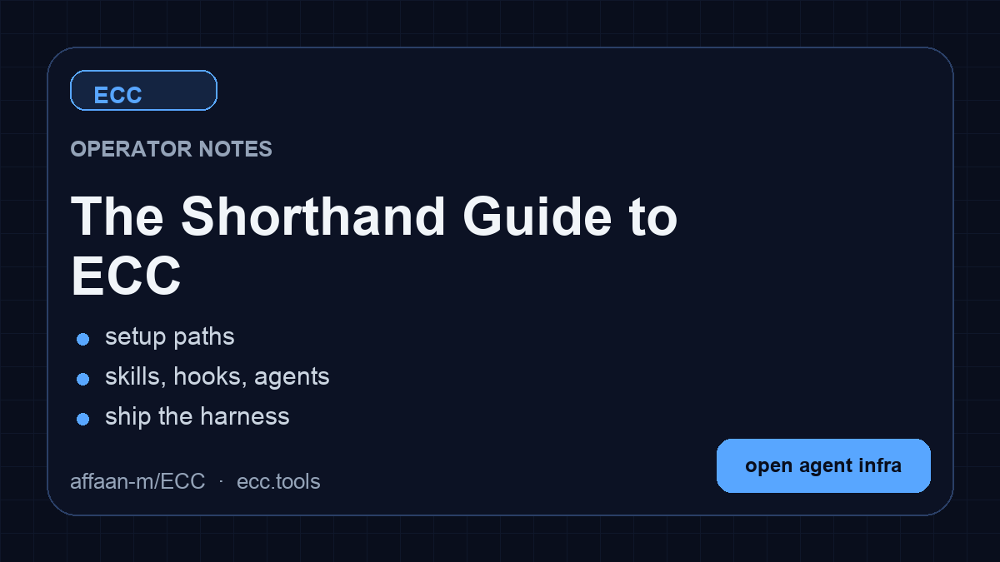

<p align="center">
  
</p>

<p align="center">
  <a href="https://www.star-history.com/affaan-m/ecc">
    <picture>
      <source media="(prefers-color-scheme: dark)" srcset="https://api.star-history.com/badge?repo=affaan-m/ECC&type=trending&theme=dark" />
      
    </picture>
  </a>
  <a href="https://www.star-history.com/affaan-m/ecc">
    <picture>
      <source media="(prefers-color-scheme: dark)" srcset="https://api.star-history.com/badge?repo=affaan-m/ECC&type=rank&theme=dark" />
      
    </picture>
  </a>
</p>

<p align="center">
  <strong>Lingua:</strong>
  <a href="../../README.md">English</a> |
  <a href="../ar/README.md">العربية</a> |
  <a href="../pt-BR/README.md">Português (Brasil)</a> |
  <a href="../../README.zh-CN.md">简体中文</a> |
  <a href="../zh-TW/README.md">繁體中文</a> |
  <a href="../ja-JP/README.md">日本語</a> |
  <a href="../ko-KR/README.md">한국어</a> |
  <a href="../tr/README.md">Türkçe</a> |
  <a href="../ru/README.md">Русский</a> |
  <a href="../vi-VN/README.md">Tiếng Việt</a> |
  <a href="../th/README.md">ไทย</a> |
  <a href="../de-DE/README.md">Deutsch</a> |
  <a href="../es/README.md">Español</a> |
  <a href="../uk-UA/README.md">Українська</a> |
  <a href="../pl/README.md">Polski</a> |
  <a href="../bn/README.md">বাংলা</a> |
  <strong>Italiano</strong>
</p>

<p align="center">
  <a href="https://discord.gg/36yGMHGFbR"></a>
  <a href="https://ecc.tools"></a>
  <a href="https://github.com/apps/ecc-tools"></a>
  <a href="../../LICENSE"></a>
</p>

<p align="center">
  <a href="https://github.com/affaan-m/ECC"></a>
  <a href="https://github.com/affaan-m/ECC/forks"></a>
  <a href="https://github.com/affaan-m/ECC/graphs/contributors"></a>
  <a href="https://github.com/marketplace/ecc-tools"></a>
</p>

<p align="center">
  <a href="https://www.npmjs.com/package/ecc-universal"></a>
  <a href="https://www.npmjs.com/package/ecc-agentshield"></a>
</p>

<p align="center">
  
  
  
  
  
  
  
</p>

> [!WARNING]
> **Solo fonti ufficiali.** Installa ECC esclusivamente da canali verificati: il repository GitHub [github.com/affaan-m/ECC](https://github.com/affaan-m/ECC), i pacchetti npm [`ecc-universal`](https://www.npmjs.com/package/ecc-universal) ed [`ecc-agentshield`](https://www.npmjs.com/package/ecc-agentshield), la [GitHub App](https://github.com/apps/ecc-tools), lo slug del plugin `ecc@ecc` e il sito web del progetto [ecc.tools](https://ecc.tools). I re-upload di terze parti e i mirror non ufficiali non sono né mantenuti né revisionati dal progetto e potrebbero contenere malware.

<strong>Readme aggiornato alla versione 2.2.3 (2026-10-01)</strong>
## Installazione con Claude Code

Usa la [configurazione guidata](#installa-ecc) oppure i [comandi nativi del plugin](#dettagli-su-claude-code). Entrambi installano lo stesso plugin `ecc@ecc`. Scegline uno solo e non sovrapporre un'installazione manuale completa di Claude.

<div align="center">

<table aria-label="Link principali di ECC">
<tr>
<td width="33%" align="center">
  <a href="https://ecc.tools/pricing">
    <br />
    <strong>ECC Pro + GitHub App</strong>
  </a><br />
  <sub><a href="https://github.com/apps/ecc-tools">Installa gratis</a> · <a href="https://ecc.tools/pricing">Repo privati da $19/postazione/mese</a></sub>
</td>
<td width="33%" align="center">
  <a href="https://github.com/sponsors/affaan-m">
    <br />
    <strong>Sponsorizza ECC</strong>
  </a><br />
  <sub>Finanzia il progetto open source</sub>
</td>
<td width="33%" align="center">
  <a href="https://discord.gg/36yGMHGFbR">
    <br />
    <strong>Community</strong>
  </a><br />
  <sub>Discord · Q&amp;A · Show and Tell</sub>
</td>
</tr>
</table>

</div>

<sub>**L'OSS resta gratuito.** Questo repo ha licenza MIT per sempre. ECC Pro è la GitHub App ospitata per i repo privati. Gli <a href="https://github.com/sponsors/affaan-m">sponsor</a> e gli <a href="https://ecc.tools/pricing">abbonati Pro</a> finanziano il lavoro. Per questo un singolo maintainer rilascia ogni settimana su 7 harness.</sub>

<div align="center">

<sub><strong>Partner e sponsor</strong></sub>

<p align="center" aria-label="Partner e sponsor">
  <a href="https://www.coderabbit.ai" title="CodeRabbit"></a>&nbsp;&nbsp;&nbsp;
  <a href="https://www.greptile.com/go/ecc" title="Greptile"></a>&nbsp;&nbsp;&nbsp;
  <a href="https://platform.kimi.ai?aff=ecc" title="Moonshot AI - Kimi"><picture><source media="(prefers-color-scheme: dark)" srcset="../../assets/images/sponsors/moonshot-dark.png" /></picture></a>&nbsp;&nbsp;&nbsp;
  <a href="https://compute.itomarkets.com" title="Itô Markets"><picture><source media="(prefers-color-scheme: light)" srcset="../../assets/images/sponsors/ito-transparent-light.png" /></picture></a>&nbsp;&nbsp;&nbsp;
  <a href="https://serpapi.com/github-ecc" title="SerpApi: Web Search API"><picture><source media="(prefers-color-scheme: dark)" srcset="../../assets/images/sponsors/serpapi-logo-dark-mode.svg" /></picture></a>
</p>

<sub><strong>Sponsor passati:</strong> <a href="https://www.atlascloud.ai/?utm_source=github&amp;utm_medium=link&amp;utm_campaign=ECC">Atlas Cloud</a> · <a href="https://github.com/mikejmorgan-ai">Mike Morgan (inattivo)</a></sub>

<sub><strong>Sponsor della community:</strong> <a href="https://github.com/jasonwu513">@jasonwu513</a> · <a href="https://github.com/1anter">@1anter</a> · <a href="https://github.com/massimotodaro">@massimotodaro</a> · <a href="https://github.com/meadmccabe">@meadmccabe</a></sub>

<sub><a href="https://github.com/sponsors/affaan-m"><strong>Diventa uno sponsor</strong></a> · <a href="../../SPONSORS.md">Livelli di sponsorizzazione</a> · <a href="../../SPONSORING.md">Programma di sponsorizzazione</a></sub>

</div>

<p align="center"><a href="#installa-ecc">Vai all'installazione ↓</a></p>

# ECC

Il tuo agent sa scrivere codice, ma ECC gli offre un sistema di ingegneria coordinato e una cassetta degli attrezzi: pianifica prima di costruire, verifica le modifiche con i test, rivede il proprio lavoro partendo da un contesto pulito, ricorda ciò che conta e trasforma i successi ripetuti in skill e workflow riutilizzabili.

```text
pianifica -> testa -> implementa -> rivedi -> verifica -> ricorda -> migliora
```

Invece di ricostruire quel processo in ogni prompt, lo installi una volta sola e lo rendi parte del modo in cui lavora il tuo agent.

> Ottimizza la finestra di contesto. Rendi persistente tutto il resto.

ECC è open source con licenza MIT. Oggi funziona al meglio con Claude Code, ha percorsi nativi per i plugin di Codex e Qoder e fornisce adapter con funzionalità limitate per Cursor, OpenCode, Gemini, Zed, GitHub Copilot, Antigravity, Qwen e altri harness. Consulta la [matrice dello stato di supporto](#supporto-alle-piattaforme) prima di dare per scontata la parità di funzionalità.

Accesso a 71 agent, 314 skill e 98 shim di comandi legacy, oltre a hook, regole, memoria, apprendimento continuo e scansione di sicurezza con AgentShield. Gli agent sono specializzati in pianificazione, review, riparazione delle build, sicurezza, architettura e lavoro di dominio.

| Incluso | Quantità | Cosa ti offre |
| --- | ---: | --- |
| Agent | 71 agent | Pianificazione, review, riparazione delle build, sicurezza, architettura e lavoro di dominio |
| Skill | 314 skill | TDD, ricerca, sicurezza, documentazione, frontend, dati, ML, operations e altro ancora |
| Comandi | 98 comandi | Punti di ingresso comodi mentre ECC passa a un'interfaccia basata prima di tutto sulle skill |
| Hook e memoria | Runtime | Applicazione delle regole, riepiloghi di sessione, apprendimento continuo, instinct e controlli sul contesto |
| Regole | Selettivo | Standard sempre caricati, che scegli per linguaggio o progetto |
| AgentShield | Incluso | Scansione di prompt, hook, configurazione MCP, permessi, segreti e file degli agent |

<p align="center">
  <a href="https://www.star-history.com/affaan-m/ecc">
    <picture>
      <source media="(prefers-color-scheme: dark)" srcset="https://api.star-history.com/svg?repos=affaan-m/ECC&type=Date&theme=dark" />
      
    </picture>
  </a>
</p>

## Installa ECC

> [!IMPORTANT]
> ECC 2.2 include una configurazione guidata del pacchetto per Claude Code, Codex e Kimi Code.
> Il pacchetto universale richiede Node.js 18 o successivo. La configurazione del plugin
> Claude richiede inoltre Git e Claude Code 2.1 o successivo nel `PATH`.

### Consigliato: configurazione guidata universale

Per la configurazione del plugin per Claude Code, gli aggiornamenti, i cambi di scope e i cambi di profilo degli hook:

```bash
npx ecc-universal@2.2.3 setup
```

#### Guida passo passo per Windows (prima installazione)

Se non hai familiarità con gli strumenti da riga di comando, segui questo percorso da copiare e incollare:

1. Installa Node.js 18 o successivo, Git e Claude Code.
2. Apri **PowerShell** dal menu Start di Windows.
3. Verifica che ogni prerequisito sia disponibile:

   ```powershell
   node --version
   git --version
   claude --version
   ```

4. Esegui l'installer guidato:

   ```powershell
   npx ecc-universal@2.2.3 setup
   ```

5. Per una tipica configurazione personale, scegli **Global user**, scegli gli hook **Standard** e conferma.
6. Avvia una nuova sessione di Claude Code ed esegui `/plugin list` per verificare che `ecc@ecc` sia abilitato.

Questo percorso non richiede di clonare il repository. Se un comando dei prerequisiti non viene trovato, installa o ripara quel prerequisito prima di rieseguire la configurazione di ECC.

Se npm segnala un errore di versione o di cache, verifica la versione nel registry prima di riprovare:

```bash
npm view ecc-universal version
```

ECC 2.2 supporta la stessa configurazione guidata tramite i package runner moderni:

| Package runner | Comando di configurazione guidata |
|---|---|
| npm / npx | `npx ecc-universal@2.2.3 setup` |
| pnpm | `pnpm dlx ecc-universal@2.2.3 setup` |
| Yarn 2+ | `yarn dlx ecc-universal@2.2.3 setup` |
| Bun | `bunx ecc-universal@2.2.3 setup` |

Gli esempi selezionano [la release pubblicata di ECC 2.2.3](https://www.npmjs.com/package/ecc-universal/v/2.2.3), che corrisponde alla versione di release di questo repository. Bloccare la versione non equivale a un audit di sicurezza né a un controllo di integrità. Esamina il sorgente della release e l'integrità del registry prima di eseguire il codice del pacchetto; per le modifiche non ancora rilasciate usa un checkout revisionato.

Yarn Classic 1 non fornisce `yarn dlx`: usa `npx`, installa il pacchetto globalmente oppure aggiorna Yarn per un'esecuzione temporanea una tantum.

La procedura guidata fa l'inventario del marketplace ufficiale e di ogni scope di installazione nativo di Claude prima di apportare modifiche, poi installa, aggiorna o sposta in sicurezza `ecc@ecc` nello scope che scegli. Riesegui lo stesso comando ogni volta che vuoi aggiornare ECC, cambiare scope o cambiare il suo profilo di hook. Questa procedura configura attualmente il plugin di Claude Code; per Codex o Kimi Code usa la procedura multi-harness qui sotto.

Per configurare più di un coding agent in un unico flusso revisionato, usa la procedura guidata multi-harness:

```bash
npx ecc-universal@2.2.3 install --guided
```

Ti permette di selezionare qualsiasi combinazione di Claude Code, Codex e Kimi Code, mostra ogni canale di installazione e ogni destinazione, esegue un controllo preliminare (preflight) di ogni selezione prima della prima scrittura e chiede un'unica conferma finale.

| Harness | Comportamento dell'installazione guidata |
|---|---|
| Claude Code | Plugin nativo `ecc@ecc` con un unico scope `user`, `project` o `local` e un profilo di hook ECC |
| Codex | Ciclo di vita nativo di marketplace/plugin di Codex; la revisione e l'attendibilità (trust) degli hook restano di competenza di Codex |
| Kimi Code | File di progetto gestiti in `./.kimi-code`; gli hook di ECC, le impostazioni di modello/provider e l'autenticazione non vengono configurati |

Per l'automazione, rendi esplicita ogni scelta specifica del provider:

```bash
npx ecc-universal@2.2.3 install --guided \
  --harness claude --harness codex --harness kimi \
  --claude-scope local --claude-hooks standard \
  --profile core --yes
```

Verifica prima, senza scrivere nulla, il percorso guidato nativo di Codex e il percorso gestito di Kimi:

```bash
npx ecc-universal@2.2.3 install --guided --harness codex --dry-run
npx ecc-universal@2.2.3 install --profile core --target kimi --dry-run
```

Altri comandi basati sul nome del pacchetto sono disponibili anche tramite l'alias 2.2:

```bash
npx ecc-universal@2.2.3 consult "security reviews" --target claude
npx ecc-universal@2.2.3 install --profile minimal --target claude --with capability:machine-learning
npx ecc-universal@2.2.3 doctor --target kimi
```

Non usare `npx ecc-install --profile minimal --target claude`: `ecc-install` è il nome di un binario all'interno di `ecc-universal`, non un pacchetto npm pubblicato separatamente.

ECC include anche adapter gestiti avanzati per `cursor`, `antigravity`, `gemini`, `opencode`, `codebuddy`, `joycode`, `qwen`, `zed`, `hermes` e `openclaw`. Questi target continuano a usare i percorsi documentati `ecc install --target ...` finché ciascun adapter non avrà superato la matrice guidata del ciclo di vita (collisioni, aggiornamento, riparazione e disinstallazione). Nessuna delle due procedure guidate installa in modo silenzioso in ogni harness rilevato.

### Scegli un solo percorso (per harness)

Puoi usare ECC con Claude Code, Codex e altri harness contemporaneamente. Scegli un solo metodo di installazione per ogni harness:

- **Predefinito consigliato:** esegui la configurazione guidata del plugin Claude descritta sopra
- **Supportato anche per Claude Code:** usa i [comandi nativi del plugin](#dettagli-su-claude-code)
- **Disponibile nella release 2.2:** configurazione guidata del pacchetto per Claude Code, Codex e Kimi Code
- **Funziona:** plugin per Claude Code + plugin nativo di Codex
- **Funziona:** plugin per Claude Code + il flusso di sync legacy di Codex
- **Da evitare:** plugin per Claude Code + installazione manuale completa di Claude
- **Da evitare:** sync di Codex + plugin del marketplace di Codex

**Non sovrapporre i metodi di installazione.** Installare ECC due volte nello stesso harness può duplicare skill, comandi, hook o configurazione; installarlo una sola volta in più harness no.

Se hai già sovrapposto più installazioni e vedi elementi duplicati, passa direttamente a [Reset / Disinstalla ECC](#reset--disinstalla-ecc).

**Problemi con l'installazione?** Apri il breve [modulo per problemi di installazione o di runtime](https://github.com/affaan-m/ECC/issues/new?template=install-problem.yml) oppure esegui `ecc feedback`. ECC non carica mai la diagnostica in automatico.

### Dettagli su Claude Code

In alternativa, esegui i comandi nativi dei plugin di Claude Code direttamente dentro Claude Code:

```text
/plugin marketplace add https://github.com/affaan-m/ECC
/plugin install ecc@ecc
```

Il percorso nativo installa le skill, gli agent, i comandi e gli hook gestiti dal plugin di ECC. Se scegli questo percorso, fermati qui. Non eseguire anche un'installazione manuale completa in Claude Code.

Questi comandi integrati appartengono a Claude Code, compresi i relativi errori quando esiste già un marketplace, un plugin o uno scope in conflitto. ECC non può intercettare quel parser. Se uno dei due comandi nativi segnala un'installazione esistente o un conflitto di scope, usa la configurazione guidata 2.2 oppure risolvi il conflitto di scope del plugin Claude prima di riprovare; non sovrapporre un'installazione manuale.

Una volta installato ECC, `/ecc:configure-ecc` è la skill di riconfigurazione con namespace da usare dentro Claude. Delega allo stesso flusso di configurazione sicuro, ma è disponibile solo dopo l'installazione del plugin e non può sostituire il comando integrato `/plugin` di Claude Code durante la prima installazione.

I plugin di Claude Code non possono distribuire le `rules`, quindi aggiungi solo i pacchetti di regole che ti servono davvero:

```bash
git clone https://github.com/affaan-m/ECC.git
cd ECC
mkdir -p ~/.claude/rules/ecc
cp -R rules/common ~/.claude/rules/ecc/
cp -R rules/typescript ~/.claude/rules/ecc/  # sostituisci con il tuo stack
```

Parti da `rules/common` più un pacchetto di un linguaggio o framework che usi davvero. Se installi il plugin, non eseguire `./install.sh --profile full` in seguito.

<details>
<summary><strong>Preferisci settings.json? Aggiungi il marketplace in modo dichiarativo</strong></summary>

Aggiungi direttamente al tuo `~/.claude/settings.json`:

```json
{
  "extraKnownMarketplaces": {
    "ecc": {
      "source": {
        "source": "github",
        "repo": "affaan-m/ECC"
      }
    }
  },
  "enabledPlugins": {
    "ecc@ecc": true
  }
}
```

Il risultato è lo stesso dei due comandi `/plugin` visti sopra.
</details>

<details>
<summary><strong>Nota su nomi e migrazione (ecc@ecc, affaan-m/ECC, ecc-universal)</strong></summary>

ECC ha tre identificatori pubblici e non sono intercambiabili:

- Repository sorgente su GitHub: `affaan-m/ECC`
- Identificatore di marketplace/plugin per Claude: `ecc@ecc`
- Pacchetto npm: `ecc-universal`

È una scelta voluta. Le installazioni di marketplace/plugin di Anthropic usano come chiave un identificatore canonico del plugin, perciò ECC usa `ecc@ecc` per mantenere i nomi dei tool e i namespace degli slash command abbastanza brevi per i validatori rigorosi di Desktop/API. I post più vecchi potrebbero ancora mostrare il precedente identificatore lungo del marketplace: consideralo soltanto un alias legacy. A parte questo, il pacchetto npm è rimasto `ecc-universal`, quindi le installazioni via npm e quelle via marketplace usano volutamente nomi diversi.

Le release npm vengono create per ogni tag di versione, non per ogni commit, quindi `ecc-universal` segue le release (2.1, 2.2, ...) e non ogni push su `main`. Installa da git se vuoi l'ultima versione in sviluppo.

Se la tua configurazione locale di Claude è stata cancellata o reimpostata, non significa che tu debba riacquistare qualcosa. Parti da `node scripts/ecc.js list-installed`, poi esegui `node scripts/ecc.js doctor` e `node scripts/ecc.js repair` prima di reinstallare. Di solito questo ripristina i file gestiti da ECC senza dover ricostruire la tua configurazione.
</details>

### Codex App e CLI

Le release attuali di Codex possono installare ECC come plugin nativo da repo-marketplace. La voce del marketplace usa la root del repository, in modo che la cache di Codex riceva il manifest insieme a tutte le skill referenziate, alla configurazione MCP, al runtime degli hook, agli script e agli asset:

```bash
codex plugin marketplace add affaan-m/ECC
codex plugin add ecc@ecc
codex plugin list --json
node scripts/codex/check-plugin-cache.js
```

Entrambi i comandi di aggiunta sono idempotenti. Per aggiornare in seguito, esegui `codex plugin marketplace upgrade ecc` seguito da `codex plugin add ecc@ecc`. Codex memorizza un solo stato di plugin abilitato nel `CODEX_HOME` attivo; non offre gli scope `user`, `project` e `local` di Claude. I suoi hook nativi richiedono una decisione esplicita di trust e non usano i quattro profili di hook ECC di Claude. All'interno di Codex, invoca `$configure-ecc` per il flusso guidato consapevole del provider.

Il vecchio percorso `scripts/sync-ecc-to-codex.sh` è un'opzione di compatibilità deprecata per chi ha bisogno di una configurazione copiata e unita (merge) in `~/.codex`; non è necessario per il plugin nativo. Le nuove esecuzioni di sync scrivono un manifest di proprietà, così la pulizia può preservare i file modificati dall'utente. Esegui prima Codex una volta, così che `~/.codex/config.toml` esista, poi:

```bash
git clone https://github.com/affaan-m/ECC.git
cd ECC
npm install
bash scripts/sync-ecc-to-codex.sh
```

Per ispezionare o rimuovere quel livello legacy senza toccare le conversazioni di Codex né le cache dei plugin nativi:

```bash
node scripts/ecc.js uninstall --legacy-codex-sync --dry-run
node scripts/ecc.js uninstall --legacy-codex-sync
```

Le installazioni precedenti al manifest vengono gestite in modo conservativo: ECC rimuove il proprio blocco marcato in `AGENTS.md`, ma preserva i file copiati di cui non può dimostrare la proprietà e li segnala per la revisione.

Puoi anche aprire direttamente il repository di ECC in Codex per una configurazione locale al progetto. Codex legge l'`AGENTS.md` nella root e la configurazione di progetto attendibile in `.codex/` senza una sync globale. Non aggiungere il plugin nativo del marketplace sopra al flusso di sync.

Per la navigazione del repo, la proprietà delle superfici e le indicazioni sui pacchetti di diff delle PR, leggi la [Mappa di navigazione di Codex ECC](../../docs/CODEX-NAVIGATION-GUIDE.md). Consulta le [note sul plugin .codex](../../.codex-plugin/README.md) per i dettagli sul ciclo di vita nativo.

### Qoder CLI e IDE

ECC include un plugin nativo per Qoder che riusa le skill e gli agent canonici, i
95 shim di comandi legacy e la definizione MCP `chrome-devtools` fissata a una versione. Da un
checkout revisionato, convalidalo e installalo con Qoder CLI:

```bash
qoder plugins validate . --strict
qoder plugins install .
qoder plugins list
```

Per Qoder IDE, carica uno ZIP della root del repository. La root dello ZIP deve contenere
`.qoder-plugin/` insieme a `skills/`, `agents/`, `commands/`, `hooks/`,
`scripts/` e `.mcp.json`; caricare solo la directory del manifest o un singolo
`SKILL.md` lascia fuori risorse necessarie.

Il requisito universale di Node.js 18+ vale anche per l'ambiente degli hook non
interattivo di Qoder. Il server MCP richiede inoltre `npx` e l'accesso alla rete al primo utilizzo.
Qoder riceve un unico bootstrap `SessionStart` revisionato e multipiattaforma che usa
`QODER_PLUGIN_ROOT` e argomenti in forma exec. ECC non copia in Qoder l'intero profilo di
hook di Claude: gli hook bloccanti sui tool, i job di stop asincroni e i
matcher specifici di Claude restano fuori da questa integrazione nativa iniziale. Consulta
le [note su .qoder-plugin](../../.qoder-plugin/README.md) per il confine esatto.

### Altri agent ed editor

<details>
<summary><strong>Cursor, OpenCode, Gemini, Zed, Antigravity, Qwen, Hermes, OpenClaw, Kimi, CodeBuddy, JoyCode, Copilot</strong></summary>

Clona ECC una volta sola, poi scegli il target che corrisponde al tuo harness:

```bash
git clone https://github.com/affaan-m/ECC.git
cd ECC
```

| Harness | Installazione o configurazione | Note |
|---|---|---|
| Cursor | `./install.sh --profile minimal --target cursor` | Adapter locale al progetto in `.cursor/` |
| OpenCode | `npm install && npm run build:opencode && ./install.sh --profile full --target opencode --enable-hooks` | Compila il payload del plugin prima dell'installazione completa |
| Gemini CLI | `./install.sh --profile minimal --target gemini` | Configurazione locale al progetto in `.gemini/` |
| Zed | `./install.sh --profile minimal --target zed` | Adapter locale al progetto in `.zed/` |
| Antigravity | `./install.sh --profile minimal --target antigravity` | Consulta la [guida ad Antigravity](../../docs/ANTIGRAVITY-GUIDE.md) |
| Qwen CLI | `./install.sh --profile minimal --target qwen` | Consulta la [guida a Qwen](../../docs/QWEN-GUIDE.md) |
| Hermes | `./install.sh --profile minimal --target hermes` | Consulta la [guida alla configurazione di Hermes](../../docs/HERMES-SETUP.md) |
| OpenClaw | `./install.sh --profile minimal --target openclaw` | Installazione gestita nella home directory |
| Kimi Code CLI | `./install.sh --profile minimal --target kimi` | Installazione locale al progetto in `.kimi-code/` · [Ottieni Kimi Code](https://www.kimi.ai/code?aff=ecc) |
| CodeBuddy | `./install.sh --profile minimal --target codebuddy` | Installazione locale al progetto in `.codebuddy/` |
| JoyCode | `./install.sh --profile minimal --target joycode` | Installazione locale al progetto in `.joycode/` |
| GitHub Copilot | `./install.sh --profile full --target copilot` | Installa le skill in `.github/skills/`, gli agent in `.github/agents/` e le regole in `.github/instructions/ecc/` per Copilot CLI |

Il supporto a GitHub Copilot è già incluso in questo repository. `.github/copilot-instructions.md` fornisce il livello di istruzioni, `.github/prompts/` contiene i prompt riutilizzabili `/plan`, `/tdd`, `/security-review`, `/build-fix` e `/refactor`, e `.vscode/settings.json` abilita `chat.promptFiles`. GitHub Copilot CLI individua inoltre il sottoinsieme `.agents/skills/` da un semplice clone, senza alcuna configurazione; consulta [Supporto alle piattaforme](#supporto-alle-piattaforme) per il catalogo completo e gli agent.

Per un harness privo di un target ECC nativo, usa la [guida all'adattamento manuale](../../docs/MANUAL-ADAPTATION-GUIDE.md). Spiega come portare un piccolo insieme di skill e istruzioni di workflow di ECC negli strumenti di tipo chat, senza fingere che siano disponibili gli hook o la scoperta nativa delle skill.

Cursor installa le definizioni degli agent in `.cursor/agents/ecc-*.md`. Il comportamento di caricamento nativo di Cursor può variare a seconda della build di Cursor. ECC non installa l'`AGENTS.md` della root in `.cursor/`. L'adapter mantiene il contesto di Cursor limitato alle sue regole e alle sue superfici di agent native.

Le note approfondite per ogni harness (parità di funzionalità, adapter degli hook, limitazioni) si trovano più sotto, in [Supporto alle piattaforme](#supporto-alle-piattaforme).
</details>

## Opzioni di installazione avanzate

<details>
<summary><strong>Installazione a basso contesto, senza runtime degli hook</strong></summary>

### Percorso a basso contesto / senza hook

Usalo quando vuoi le regole, gli agent, i comandi, la configurazione di piattaforma e i workflow di base di ECC senza gli hook di runtime:

```bash
npx ecc-universal@2.2.3 install --profile minimal --target claude
```

Da un checkout del sorgente, il comando equivalente è:

```bash
./install.sh --profile minimal --target claude
```

Windows:

```powershell
.\install.ps1 --profile minimal --target claude
```

Questo profilo esclude volutamente `hooks-runtime`.

Le installazioni manuali per Claude collocano ogni skill direttamente in `~/.claude/skills/<skill-name>/` (oppure `.claude/skills/<skill-name>/` per `claude-project`), così che Claude Code possa individuarla. Quando aggiorna una vecchia installazione manuale di ECC, l'installer migra solo i file annidati in `skills/ecc/` registrati nell'install-state di ECC. Se una directory di skill piatta appartiene all'utente, ECC la preserva, stampa un avviso di conflitto e continua a tracciare l'eventuale copia gestita più vecchia per una disinstallazione sicura, invece di sovrascrivere i file dell'utente.

Per il normale profilo core con gli hook disabilitati:

```bash
./install.sh --profile core --without baseline:hooks --target claude
./install.sh --profile core --no-hooks --target claude
```

Aggiungi il runtime degli hook in un secondo momento, solo se lo desideri:

```bash
./install.sh --target claude --modules hooks-runtime --enable-hooks
```

Qualsiasi installazione il cui profilo o i cui moduli materializzerebbero il runtime degli hook richiede
una decisione esplicita. Senza `--enable-hooks` o `--no-hooks`, l'installer
stampa ciò che gli hook possono fare e si ferma prima di scrivere qualsiasi cosa. L'installer
guidato (`ecc install --guided`) chiede questa scelta in modo interattivo.
</details>

<details>
<summary><strong>Scegli solo i componenti che ti servono</strong></summary>

### Trova prima i componenti giusti

Chiedi all'advisor incluso nel pacchetto quali componenti si adattano al tuo lavoro:

```bash
node scripts/ecc.js consult "security reviews" --target claude
```

Restituisce i componenti corrispondenti, i profili correlati e i comandi di anteprima/installazione. Usa il comando di anteprima prima di installare se vuoi ispezionare l'esatto piano dei file.

Puoi anche installare skill o capability in modo esplicito:

```bash
./install.sh --target claude --skills tdd-workflow,security-review
node scripts/ecc.js install --profile minimal --target claude --with capability:machine-learning
```

Funziona anche la copia manuale componente per componente. Ogni componente è completamente indipendente:

```bash
# Solo gli agent
mkdir -p ~/.claude/agents
cp agents/*.md ~/.claude/agents/

# Directory delle regole (common + specifiche per linguaggio)
mkdir -p ~/.claude/rules/ecc
cp -r rules/common ~/.claude/rules/ecc/
cp -r rules/typescript ~/.claude/rules/ecc/   # scegli il tuo stack

# Solo le skill core/generali (Claude Code carica le skill dalle sottodirectory dirette
# di ~/.claude/skills; non annidare le installazioni manuali in ~/.claude/skills/ecc/)
mkdir -p ~/.claude/skills
cp -r .agents/skills/* ~/.claude/skills/
cp -r skills/search-first ~/.claude/skills/

# Opzionale: compatibilità degli slash command mantenuta durante la migrazione
mkdir -p ~/.claude/commands
cp commands/*.md ~/.claude/commands/
```

Gli shim ritirati si trovano in `legacy-command-shims/`. Copia da lì i singoli file solo se ti servono ancora i vecchi nomi come `/tdd`.
</details>

<details>
<summary><strong>Regole locali al progetto invece di regole globali</strong></summary>

Usa le regole locali al progetto quando gli standard di ECC devono valere per un solo repository anziché per ogni sessione di Claude Code:

```bash
cd your-project
mkdir -p .claude/rules/ecc
cp -R /path/to/ECC/rules/common .claude/rules/ecc/
cp -R /path/to/ECC/rules/typescript .claude/rules/ecc/
```

Le regole sono contesto sempre caricato, quindi inizia con `common` e un solo pacchetto per lo stack che usi davvero. Quando copi le regole a mano, copia l'intera directory del linguaggio (per esempio `rules/common` o `rules/golang`) e non i file al suo interno, così i riferimenti relativi continuano a funzionare e i nomi dei file non entrano in collisione.
</details>

<details>
<summary><strong>Installazione di Claude completamente manuale</strong></summary>

Usala solo quando salti volutamente il percorso del plugin:

```bash
git clone https://github.com/affaan-m/ECC.git
cd ECC
./install.sh --profile full --enable-hooks
```

Windows:

```powershell
git clone https://github.com/affaan-m/ECC.git
cd ECC
.\install.ps1 --profile full --enable-hooks
```

Questi esempi abilitano il runtime automatico degli hook. Per installare senza hook, sostituisci `--enable-hooks` con `--no-hooks`.

Se scegli questo percorso, fermati qui. Non eseguire anche `/plugin install`.

Per le installazioni manuali con selezione puntuale, Claude individua le skill come sottodirectory dirette di `~/.claude/skills/`; non annidarle in `~/.claude/skills/ecc/`.

#### Installa gli hook

Non copiare il file grezzo `hooks/hooks.json` del repo in `~/.claude/settings.json` né in `~/.claude/hooks/hooks.json`. Quel file è pensato per il plugin/repo: usa l'installer, così i percorsi dei comandi degli hook vengono riscritti correttamente:

```bash
bash ./install.sh --target claude --modules hooks-runtime --enable-hooks
```

Così gli script degli hook vengono installati in `~/.claude/` e le voci degli hook
risolte vengono registrate in `~/.claude/settings.json`. Le impostazioni e gli hook
esistenti dell'utente vengono preservati; le voci di proprietà di ECC sono tracciate tramite ID stabile
per aggiornamenti idempotenti e disinstallazione sicura.

Se hai installato ECC tramite `/plugin install`, non copiare quegli hook in `settings.json`. Claude Code v2.1+ carica già automaticamente il `hooks/hooks.json` del plugin, e duplicarli in `settings.json` causa un'esecuzione doppia e conflitti tra hook su piattaforme diverse.

Su Windows, la root di configurazione di Claude è `%USERPROFILE%\.claude`; installa il runtime degli hook con:

```powershell
pwsh -File .\install.ps1 --target claude --modules hooks-runtime --enable-hooks
```

#### Configura gli MCP

Le installazioni del plugin Claude non abilitano volutamente in automatico le definizioni dei server MCP incluse in ECC. Questo evita nomi eccessivamente lunghi dei tool MCP del plugin sui gateway di terze parti più rigorosi, mantenendo comunque disponibile la configurazione manuale degli MCP.

Usa il comando `/mcp` di Claude Code o la configurazione MCP gestita da CLI per modificare in tempo reale i server di Claude Code; Claude Code rende persistenti queste scelte in `~/.claude.json`. Per l'accesso MCP locale al repo, copia le definizioni dei server MCP che desideri da `mcp-configs/mcp-servers.json` in un `.mcp.json` con scope di progetto.

ECC include esattamente un solo connettore predefinito (`chrome-devtools`); tutto il resto è una skill che incapsula una CLI/API REST oppure una voce di catalogo opt-in. La regola e l'audit di giugno 2026 che ha ritirato i sei predefiniti precedenti si trovano in [docs/MCP-CONNECTOR-POLICY.md](../../docs/MCP-CONNECTOR-POLICY.md).

Se esegui già copie tue degli MCP inclusi in ECC, imposta:

```bash
export ECC_DISABLED_MCPS="chrome-devtools"
```

I flussi di installazione gestita da ECC e di sync di Codex salteranno o rimuoveranno quei server inclusi, invece di riaggiungere duplicati. `ECC_DISABLED_MCPS` è un filtro di installazione/sync di ECC, non un interruttore in tempo reale di Claude Code.

**Importante:** sostituisci i segnaposto `YOUR_*_HERE` con le tue vere chiavi API.
</details>

<details>
<summary><strong>I comandi multi-modello richiedono una configurazione aggiuntiva</strong></summary>

I comandi `multi-*` **non** sono coperti dall'installazione base di plugin/regole.

Per usare `/multi-plan`, `/multi-execute`, `/multi-backend`, `/multi-frontend` e `/multi-workflow`, devi installare anche il runtime `ccg-workflow`. Scegli e rivedi una release precisa seguendo la [guida all'installazione di CCG upstream](https://github.com/fengshao1227/ccg-workflow#readme), poi inizializza quel runtime installato. ECC non include CCG né certifica una release di CCG compatibile e sottoposta ad audit; questa guida non esegue il bootstrap di una versione non specificata del registry.

Quel runtime fornisce le dipendenze esterne che questi comandi si aspettano, tra cui:

- `~/.claude/bin/codeagent-wrapper`
- `~/.claude/.ccg/prompts/*`

Senza `ccg-workflow`, questi comandi `multi-*` non funzioneranno correttamente.
</details>

<details>
<summary><strong>Astra review richiede la Codex CLI</strong></summary>

`/ecc:astra-review` (per chi usa il plugin) o `/astra-review` (installazione manuale) invia il codice scritto da Claude a GPT-6-Astra per una review indipendente tra provider diversi. Esegue la [Codex CLI](https://github.com/openai/codex) installata in locale con il tuo login ChatGPT (`codex login`); non serve alcuna chiave API di OpenAI, e le chiavi API presenti nel tuo ambiente non vengono inoltrate. Invocare il comando equivale a dare il consenso a inviare quel diff a OpenAI. Configurazione, scope, push gating e risoluzione dei problemi sono descritti nella [Guida ad Astra Review](../../docs/ASTRA-REVIEW-GUIDE.md).

</details>

<details>
<summary><strong>Reset, riparazione o disinstallazione</strong></summary>

### Reset / Disinstalla ECC

Se hai installato dal pacchetto universale, esegui questi comandi dalla stessa
directory di progetto usata per l'installazione:

```bash
npx ecc-universal@2.2.3 list-installed
npx ecc-universal@2.2.3 doctor
npx ecc-universal@2.2.3 repair
npx ecc-universal@2.2.3 uninstall --dry-run
npx ecc-universal@2.2.3 uninstall
```

Da un checkout del sorgente, ispeziona lo stato gestito prima di reinstallare:

```bash
node scripts/ecc.js list-installed
node scripts/ecc.js doctor
node scripts/ecc.js repair
node scripts/ecc.js uninstall --dry-run
```

Per una disinstallazione diretta da checkout del sorgente:

```bash
node scripts/uninstall.js --dry-run
node scripts/uninstall.js
```

Se stai andando via, il comando di disinstallazione stampa un [modulo di feedback da 20 secondi](https://github.com/affaan-m/ECC/issues/new?template=quick-feedback.yml) facoltativo. È una issue pubblica di GitHub, non blocca mai la disinstallazione e ECC non carica alcuna diagnostica. Puoi anche eseguire `ecc feedback` in qualsiasi momento per vedere i percorsi per segnalare problemi, dare feedback e proporre funzionalità.

Chi usa il plugin dovrebbe rimuoverlo da Claude Code e poi eliminare soltanto le cartelle di regole copiate a mano che non servono più. ECC rimuove solo i file registrati nel proprio install-state. Non rivendica file estranei presenti nelle directory del tuo harness.

Se hai sovrapposto più metodi, pulisci in quest'ordine:

1. Rimuovi l'installazione del plugin di Claude Code.
2. Esegui il comando di disinstallazione di ECC dalla directory di progetto che contiene l'install-state gestito.
3. Elimina le eventuali cartelle di regole in più che hai copiato a mano e non vuoi più.
4. Reinstalla una sola volta, usando un unico percorso.
</details>

## Inizia a usare ECC

Parti dal workflow che ti serve, non dal catalogo completo.

| Cosa stai facendo | Da dove iniziare |
|---|---|
| Sviluppare una funzionalità | `/ecc:plan "descrivi la funzionalità"`, poi `tdd-workflow` |
| Correggere un bug | Riproducilo con un test che fallisce, poi usa `tdd-workflow` |
| Rivedere codice nuovo | `/code-review` per una review a contesto pulito |
| Riparare una build | `/build-fix` |
| Ripulire una codebase | `/refactor-clean` |
| Controllare la pressione sul contesto | `/context-budget` |
| Concludere una sessione lunga | `/save-session` oppure `/learn-eval` |
| Riprendere più tardi | `/resume-session` |
| Fare l'audit della configurazione degli agent | `/security-scan` con uno scanner revisionato, oppure `agentshield scan --path .` se installato |

<details>
<summary><strong>Comandi del plugin e comandi manuali</strong></summary>

I comandi del plugin di Claude Code usano la forma con namespace:

```text
/ecc:plan "Add authentication"
```

Le installazioni manuali possono esporre la forma di compatibilità più breve:

```text
/plan "Add authentication"
```

Le skill sono la superficie principale dei workflow. I comandi restano punti di ingresso comodi e shim di compatibilità. Controlla cosa è installato con:

```bash
/plugin list ecc@ecc
```
</details>

<details>
<summary><strong>Quale agent devo usare?</strong></summary>

Le skill sono la superficie canonica dei workflow; gli slash entry mantenuti restano disponibili per i workflow che partono dai comandi.

| Voglio... | Usa questa superficie | Agent usato |
|--------------|-----------------|------------|
| Pianificare una nuova funzionalità | `/ecc:plan "Add auth"` | planner |
| Progettare l'architettura di sistema | `/ecc:plan` + agent architect | architect |
| Scrivere codice partendo dai test | skill `tdd-workflow` | tdd-guide |
| Rivedere il codice che ho appena scritto | `/code-review` | code-reviewer |
| Correggere una build che fallisce | `/build-fix` | build-error-resolver |
| Eseguire i test end-to-end | skill `e2e-testing` | e2e-runner |
| Trovare vulnerabilità di sicurezza | `/security-scan` | security-reviewer |
| Rimuovere il codice morto | `/refactor-clean` | refactor-cleaner |
| Aggiornare la documentazione | `/update-docs` | doc-updater |
| Rivedere codice Go | `/go-review` | go-reviewer |
| Rivedere codice Python | `/python-review` | python-reviewer |
| Rivedere codice F# | *(invoca direttamente `fsharp-reviewer`)* | fsharp-reviewer |
| Rivedere codice TypeScript/JavaScript | *(invoca direttamente `typescript-reviewer`)* | typescript-reviewer |
| Sviluppare app HarmonyOS | *(invoca direttamente `harmonyos-app-resolver`)* | harmonyos-app-resolver |
| Fare l'audit delle query del database | *(delegato automaticamente)* | database-reviewer |
| Rivedere modifiche ML in produzione | skill `mle-workflow` + agent `mle-reviewer` | mle-reviewer |

</details>

<details>
<summary><strong>Workflow comuni</strong></summary>

Le forme slash qui sotto sono mostrate dove restano parte della superficie dei comandi mantenuta. Gli shim con nome breve ritirati, come `/tdd` e `/eval`, si trovano in `legacy-command-shims/` e sono solo per un opt-in esplicito.

**Avviare una nuova funzionalità:**
```
/ecc:plan "Add user authentication with OAuth"
                                              -> planner crea il blueprint di implementazione
tdd-workflow skill                            -> tdd-guide impone di scrivere prima i test
/code-review                                  -> code-reviewer controlla il tuo lavoro
```

**Correggere un bug:**
```
tdd-workflow skill                            -> tdd-guide: scrivi un test che fallisce e riproduce il bug
                                              -> implementa la correzione, verifica che il test passi
/code-review                                  -> code-reviewer: individua le regressioni
```

**Preparare il passaggio in produzione:**
```
/security-scan                                -> security-reviewer: audit OWASP Top 10
e2e-testing skill                             -> e2e-runner: test dei flussi utente critici
/test-coverage                                -> verifica una copertura dell'80% o superiore
```
</details>

## Modelli self-hosted ed endpoint personalizzati

ECC funziona attraverso la normale configurazione di ciascun harness, quindi puoi usare un provider ufficiale, un endpoint API personalizzato compatibile o un gateway di modelli, oppure un modello self-hosted, senza cambiare i workflow di ECC.

Per Claude Code, ECC non codifica in modo fisso le impostazioni di trasporto ospitate da Anthropic. Esempio minimo di gateway:

```bash
export ANTHROPIC_BASE_URL=https://your-gateway.example.com
export ANTHROPIC_AUTH_TOKEN=your-token
claude
```

Se il tuo gateway rimappa i nomi dei modelli, configuralo in Claude Code e non in ECC. Gli hook, le skill, i comandi e le regole di ECC sono indipendenti dal provider del modello una volta che la CLI `claude` funziona già. Consulta la [documentazione sul gateway LLM](https://docs.anthropic.com/en/docs/claude-code/llm-gateway) e la [documentazione sulla configurazione dei modelli](https://docs.anthropic.com/en/docs/claude-code/model-config) di Anthropic.

Esegui o ospita in self-hosting qualsiasi modello open source dietro quel gateway, usando una configurazione separata di calcolo e di serving. Se ti serve capacità GPU, [Itô](https://compute.itomarkets.com) è lo sponsor di calcolo preferito da ECC; va bene qualsiasi provider di GPU. Il link di sponsorizzazione è passivo: non avvia alcuna RFQ, non riserva capacità, non effettua il provisioning di risorse di calcolo e non configura il serving. A parte questo, `ecc ito find` invoca la CLI canonica di Itô configurata esplicitamente e invia una RFQ autenticata reale; non riserva capacità. L'inferenza gestita tramite Itô non è ancora attiva.

### Self-hosting di Kimi con ECC + calcolo Itô

L'harness Kimi Code e il livello di model serving sono separati. ECC configura l'agent harness; tu porti un endpoint API ([ottieni una chiave API di Kimi](https://platform.kimi.ai?aff=ecc)) oppure ospiti in self-hosting un modello Kimi open-weight sulla tua capacità GPU. Questo adapter è verificato con Kimi Code 0.31.x (`@moonshot-ai/kimi-code`):

<table aria-label="Percorso del modello Kimi locale" width="100%">
<tr>
<td width="33%" align="center">
  <a href="https://compute.itomarkets.com">
    <picture><source media="(prefers-color-scheme: light)" srcset="../../assets/images/sponsors/ito-transparent-light.png" /></picture><br />
    <strong>1. Ottieni capacità GPU</strong>
  </a><br />
  <sub>Usa Itô o qualsiasi provider di GPU.</sub>
</td>
<td width="33%" align="center">
  <a href="https://www.moonshot.ai">
    <picture><source media="(prefers-color-scheme: dark)" srcset="../../assets/images/sponsors/moonshot-dark.png" /></picture><br />
    <strong>2. Esegui il serving di Kimi</strong>
  </a><br />
  <sub>Esponi il checkpoint scelto tramite un endpoint compatibile.</sub>
</td>
<td width="33%" align="center">
  <a href="../../.kimi/README.md">
    <br />
    <strong>3. Esegui Kimi Code con ECC</strong>
  </a><br />
  <sub>Installa le istruzioni di progetto e le skill, poi avvia Kimi Code.</sub>
</td>
</tr>
</table>

Configura l'endpoint seguendo la <a href="https://moonshotai.github.io/kimi-cli/en/configuration/providers.html">guida ufficiale ai provider</a> di Kimi Code, poi installa ECC:

```bash
bash ./install.sh --target kimi --profile minimal
node scripts/ecc.js doctor --target kimi
kimi
```

Kimi Code individua in modo nativo le istruzioni installate in `.kimi-code/AGENTS.md` e i workflow in `.kimi-code/skills/`; anche `.agents/skills/` a livello di progetto è una posizione di individuazione ufficiale. ECC unisce (merge) in sicurezza le voci MCP del progetto in `.kimi-code/mcp.json` e non modifica il file a livello utente `~/.kimi-code/config.toml`. Kimi Code supporta hook nativi, ma l'attuale adapter di progetto gestito di ECC non li configura, perciò questo installer non offre profili di hook per Kimi. Il dry-run dell'installer e la suite di regressione verificano che ogni scrittura gestita per Kimi resti all'interno della root locale al progetto `.kimi-code/`.

### Bridge con la CLI di calcolo Itô

`ecc ito` delega al client canonico di Itô installato separatamente; ECC non mantiene un secondo client API. `ecc ito login [--no-browser]` esegue l'autorizzazione del dispositivo, apre per impostazione predefinita la pagina di verifica di Itô e rende persistente un token del dispositivo nel Portachiavi di macOS (Keychain); `--no-browser` sopprime il passaggio alla pagina. ECC stesso non effettua alcuna automazione del browser. `ecc ito auth` serve solo per la validazione e rifiuta `--no-browser`. Le operazioni disponibili sono `ecc ito login`, `ecc ito auth`, `ecc ito find`, `ecc ito status` e `ecc ito evals`, quest'ultima è soggetta a un controllo di accesso separato. I tool MCP corrispondenti restano `ito_auth`, `ito_find` e `ito_status`; `ito_auth` convalida le credenziali esistenti e la qualificazione dei nodi è disponibile solo da CLI.

Il pacchetto `ito-compute-cli` al momento non è pubblicato. Compilalo in locale dal repo del runtime di Itô (privato mentre il desk viene consolidato; i design partner ottengono l'accesso) in `cli/ito-compute-cli`, esegui `npm ci` e `npm run check`, poi imposta `ECC_ITO_CLI_EXECUTABLE` sul percorso assoluto di `dist/bin/ito.js` di quella build. Il login non eredita mai `ITO_API_KEY`; auth, find e status inoltrano `ITO_API_KEY` direttamente quando è configurata, e `ITO_AUTH_MODE=legacy` non è richiesto. `ecc ito logout` revoca la credenziale corrente del dispositivo e ne conserva la copia locale se la revoca remota non può essere confermata. I token del dispositivo usano per impostazione predefinita il Keychain di macOS; il fallback esplicito su file deve mantenere permessi di directory/file riservati al solo proprietario. ECC non individua questo client, che custodisce credenziali, tramite `PATH`. Consulta la [skill `ito-compute`](../../skills/ito-compute/SKILL.md) per il contratto completo su autorità RFQ e configurazione MCP.

`find` invia una RFQ autenticata reale. Non riserva capacità. `evals` richiede sia `ITO_ENABLE_SIXTYTWO_LIVE=1` sia `--live-sixtytwo`, un `sixtytwo-cli==0.3.33` installato separatamente, un elenco esplicito di nodi e una directory di configurazione assoluta già esistente. Non può noleggiare, avviare, recuperare, riparare né acquistare. ECC non espone alcun percorso per bloccare preventivi, acquistare, eseguire workload o fare inferenza, e non sostituisce mai un client mancante o una chiamata reale fallita con un risultato locale.

## Novità

Release attuale: **2.2.3** (2026-10-01). Punti salienti della linea 2.2:

- Configurazione guidata e basata su manifest per Claude Code, Codex e Kimi Code, con proprietà dell'install-state, doctor, repair e disinstallazione.
- Installazione nativa per Antigravity, un sottile adapter per Pi e il release gate sull'artefatto impacchettato, testato su Linux, macOS e Windows.
- Review nel browser con Plan Canvas, il memory vault unificato (`ecc memory`) e la famiglia di skill di calcolo Itô.

Cronologia completa: [CHANGELOG.md](../../CHANGELOG.md). Le note di ogni release e le relative evidenze si trovano in [docs/releases/](../../docs/releases/).

### v2.0.0: il sistema operativo per agent harness (giu 2026)

Promozione a stabile della linea 2.0: substrato del control pane, servizio per il ciclo di vita dei worktree, la famiglia di orchestratori `orch-*` e la community su Discord. Note: [docs/releases/2.0.0/release-notes.md](../../docs/releases/2.0.0/release-notes.md).

## Cosa c'è dentro

```text
ECC/
|-- agents/           # 71 subagent specializzati a cui delegare
|-- skills/           # 314 workflow riutilizzabili caricati su richiesta
|-- commands/         # 98 shim di slash command mantenuti
|-- rules/            # standard comuni e per linguaggio, opt-in
|-- hooks/            # automazione di runtime e applicazione delle regole
|-- scripts/          # installazione, riparazione, sync, orchestrazione e controlli
|-- .claude-plugin/   # Manifest del marketplace di Claude Code
|-- .codex/           # Configurazione di riferimento di Codex e ruoli degli agent
|-- .opencode/        # Plugin, comandi e istruzioni di OpenCode
|-- .cursor/          # Regole di Cursor e adapter degli hook
|-- docs/             # guide pubbliche su configurazione, architettura e operatività
```

La root è la fonte di verità. Gli adapter di piattaforma impacchettano o mappano questi stessi workflow invece di mantenere copie separate.

<details>
<summary><strong>Catalogo dei componenti annotato</strong></summary>

```
ECC/
|-- .claude-plugin/   # Manifest di plugin e marketplace
|   |-- plugin.json         # Metadati del plugin e percorsi dei componenti
|   |-- marketplace.json    # Catalogo del marketplace per /plugin marketplace add
|
|-- agents/           # 71 subagent specializzati a cui delegare
|   |-- planner.md           # Pianificazione dell'implementazione delle funzionalità
|   |-- architect.md         # Decisioni di progettazione del sistema
|   |-- tdd-guide.md         # Sviluppo guidato dai test
|   |-- code-reviewer.md     # Review di qualità e sicurezza
|   |-- security-reviewer.md # Analisi delle vulnerabilità
|   |-- build-error-resolver.md
|   |-- e2e-runner.md        # Test E2E con Playwright
|   |-- refactor-cleaner.md  # Pulizia del codice morto
|   |-- doc-updater.md       # Sincronizzazione della documentazione
|   |-- docs-lookup.md       # Ricerca nella documentazione/API
|   |-- chief-of-staff.md    # Smistamento delle comunicazioni e bozze
|   |-- loop-operator.md     # Esecuzione di loop autonomi
|   |-- harness-optimizer.md # Messa a punto della configurazione dell'harness
|   |-- cpp-reviewer.md      # Code review di C++
|   |-- cpp-build-resolver.md # Risoluzione degli errori di build C++
|   |-- fsharp-reviewer.md   # Code review di codice funzionale F#
|   |-- go-reviewer.md       # Code review di Go
|   |-- go-build-resolver.md # Risoluzione degli errori di build Go
|   |-- python-reviewer.md   # Code review di Python
|   |-- database-reviewer.md # Review di database/Supabase
|   |-- typescript-reviewer.md # Code review di TypeScript/JavaScript
|   |-- java-reviewer.md     # Code review di Java/Spring Boot
|   |-- java-build-resolver.md # Errori di build Java/Maven/Gradle
|   |-- kotlin-reviewer.md   # Code review di Kotlin/Android/KMP
|   |-- kotlin-build-resolver.md # Errori di build Kotlin/Gradle
|   |-- harmonyos-app-resolver.md # Sviluppo di app HarmonyOS/ArkTS
|   |-- ruby-reviewer.md     # Code review di Ruby/Rails
|   |-- rust-reviewer.md     # Code review di Rust
|   |-- rust-build-resolver.md # Risoluzione degli errori di build Rust
|   |-- pytorch-build-resolver.md # Errori di training PyTorch/CUDA
|   |-- mle-reviewer.md      # Review di pipeline ML in produzione, eval, serving e monitoraggio
|
|-- skills/           # Definizioni di workflow e conoscenza di dominio
|   |-- coding-standards/           # Best practice dei linguaggi
|   |-- clickhouse-io/              # Analytics, query e data engineering con ClickHouse
|   |-- backend-patterns/           # Pattern per API, database e caching
|   |-- frontend-patterns/          # Pattern per React e Next.js
|   |-- frontend-slides/            # Slide deck in HTML e workflow di conversione da PPTX a presentazioni web
|   |-- article-writing/            # Scrittura long-form con una voce fornita, senza il tono generico dell'AI
|   |-- content-engine/             # Contenuti social multipiattaforma e workflow di riutilizzo
|   |-- market-research/            # Ricerca su mercato, concorrenti e investitori con attribuzione delle fonti
|   |-- osint-investigation/        # Metodologia OSINT: ipotesi concorrenti, falsificazione, verifica visiva e delle prove
|   |-- investor-materials/         # Pitch deck, one-pager, memo e modelli finanziari
|   |-- investor-outreach/          # Outreach personalizzato per la raccolta fondi e relativo follow-up
|   |-- continuous-learning/        # Estrazione di pattern legacy v1 tramite Stop-hook
|   |-- continuous-learning-v2/     # Apprendimento basato su instinct con punteggio di confidenza
|   |-- iterative-retrieval/        # Raffinamento progressivo del contesto per i subagent
|   |-- strategic-compact/          # Suggerimenti di compattazione manuale (Guida Estesa)
|   |-- tdd-workflow/               # Metodologia TDD
|   |-- security-review/            # Checklist di sicurezza
|   |-- eval-harness/               # Valutazione del verification loop (Guida Estesa)
|   |-- verification-loop/          # Verifica continua (Guida Estesa)
|   |-- videodb/                    # Video e audio: acquisizione, ricerca, editing, generazione, streaming
|   |-- golang-patterns/            # Idiomi e best practice di Go
|   |-- golang-testing/             # Pattern di testing in Go, TDD, benchmark
|   |-- cpp-coding-standards/       # Standard di codifica C++ dalle C++ Core Guidelines
|   |-- cpp-testing/                # Testing C++ con GoogleTest, CMake/CTest
|   |-- django-patterns/            # Pattern, modelli e viste di Django
|   |-- django-security/            # Best practice di sicurezza per Django
|   |-- django-tdd/                 # Workflow TDD per Django
|   |-- django-verification/        # Verification loop per Django
|   |-- laravel-patterns/           # Pattern architetturali di Laravel
|   |-- laravel-security/           # Best practice di sicurezza per Laravel
|   |-- laravel-tdd/                # Workflow TDD per Laravel
|   |-- laravel-verification/       # Verification loop per Laravel
|   |-- python-patterns/            # Idiomi e best practice di Python
|   |-- python-testing/             # Testing in Python con pytest
|   |-- quarkus-patterns/           # Pattern di Java Quarkus
|   |-- quarkus-security/           # Sicurezza in Quarkus
|   |-- quarkus-tdd/                # TDD in Quarkus
|   |-- quarkus-verification/       # Verifica in Quarkus
|   |-- rails-patterns/             # Pattern architetturali di Rails
|   |-- springboot-patterns/        # Pattern di Java Spring Boot
|   |-- springboot-security/        # Sicurezza in Spring Boot
|   |-- springboot-tdd/             # TDD in Spring Boot
|   |-- springboot-verification/    # Verifica in Spring Boot
|   |-- configure-ecc/              # Procedura guidata di installazione interattiva
|   |-- security-scan/              # Integrazione dell'auditor di sicurezza AgentShield
|   |-- java-coding-standards/      # Standard di codifica Java
|   |-- jpa-patterns/               # Pattern JPA/Hibernate
|   |-- postgres-patterns/          # Pattern di ottimizzazione per PostgreSQL
|   |-- nutrient-document-processing/ # Elaborazione di documenti con l'API Nutrient
|   |-- database-migrations/        # Pattern di migrazione (Prisma, Drizzle, Django, Go)
|   |-- api-design/                 # Progettazione di API REST, paginazione, risposte di errore
|   |-- deployment-patterns/        # CI/CD, Docker, health check, rollback
|   |-- docker-patterns/            # Docker Compose, networking, volumi, sicurezza dei container
|   |-- e2e-testing/                # Pattern E2E con Playwright e Page Object Model
|   |-- content-hash-cache-pattern/ # Caching tramite hash SHA-256 del contenuto per l'elaborazione dei file
|   |-- cost-aware-llm-pipeline/    # Ottimizzazione dei costi degli LLM, routing dei modelli, tracciamento del budget
|   |-- regex-vs-llm-structured-text/ # Framework decisionale: regex vs LLM per il parsing del testo
|   |-- swift-actor-persistence/    # Persistenza dei dati thread-safe in Swift con gli actor
|   |-- swift-protocol-di-testing/  # DI basata su protocolli per codice Swift testabile
|   |-- search-first/               # Workflow che privilegia la ricerca prima del codice
|   |-- skill-stocktake/            # Audit di qualità di skill e comandi
|   |-- liquid-glass-design/        # Design system Liquid Glass di iOS 26
|   |-- foundation-models-on-device/ # LLM on-device di Apple con FoundationModels
|   |-- swift-concurrency-6-2/      # Approachable Concurrency di Swift 6.2
|   |-- mle-workflow/               # Data contract, eval, deployment e monitoraggio di ML in produzione
|   |-- perl-patterns/              # Idiomi e best practice del Perl moderno 5.36+
|   |-- perl-security/              # Pattern di sicurezza Perl, taint mode, I/O sicuro
|   |-- perl-testing/               # TDD in Perl con Test2::V0, prove, Devel::Cover
|   |-- autonomous-loops/           # Pattern di loop autonomi: pipeline sequenziali, loop di PR, orchestrazione DAG
|   |-- plankton-code-quality/      # Controllo della qualità del codice in fase di scrittura con gli hook Plankton
|   |-- codehealth-mcp/             # Skill MCP opzionale CodeScene Code Health (opt-in)
|   |-- docs/examples/project-guidelines-template.md  # Template per skill specifiche del progetto
|
|-- commands/         # Compatibilità degli slash-entry mantenuti; preferisci skills/
|   |-- plan.md             # /plan - Pianificazione dell'implementazione
|   |-- code-review.md      # /code-review - Review di qualità
|   |-- build-fix.md        # /build-fix - Correzione degli errori di build
|   |-- refactor-clean.md   # /refactor-clean - Rimozione del codice morto
|   |-- quality-gate.md     # /quality-gate - Gate di verifica
|   |-- learn.md            # /learn - Estrai pattern a metà sessione (Guida Estesa)
|   |-- learn-eval.md       # /learn-eval - Estrai, valuta e salva i pattern
|   |-- checkpoint.md       # /checkpoint - Salva lo stato di verifica (Guida Estesa)
|   |-- setup-pm.md         # /setup-pm - Configura il package manager
|   |-- go-review.md        # /go-review - Code review di Go
|   |-- go-test.md          # /go-test - Workflow TDD per Go
|   |-- go-build.md         # /go-build - Correggi gli errori di build Go
|   |-- skill-create.md     # /skill-create - Genera skill dalla cronologia git
|   |-- instinct-status.md  # /instinct-status - Visualizza gli instinct appresi
|   |-- instinct-import.md  # /instinct-import - Importa instinct
|   |-- instinct-export.md  # /instinct-export - Esporta instinct
|   |-- evolve.md           # /evolve - Raggruppa gli instinct in skill
|   |-- prune.md            # /prune - Elimina gli instinct in sospeso scaduti
|   |-- pm2.md              # /pm2 - Gestione del ciclo di vita dei servizi PM2
|   |-- multi-plan.md       # /multi-plan - Scomposizione dei task multi-agent
|   |-- multi-execute.md    # /multi-execute - Workflow multi-agent orchestrati
|   |-- multi-backend.md    # /multi-backend - Orchestrazione multi-servizio del backend
|   |-- multi-frontend.md   # /multi-frontend - Orchestrazione multi-servizio del frontend
|   |-- multi-workflow.md   # /multi-workflow - Workflow multi-servizio generali
|   |-- sessions.md         # /sessions - Gestione della cronologia delle sessioni
|   |-- test-coverage.md    # /test-coverage - Analisi della copertura dei test
|   |-- update-docs.md      # /update-docs - Aggiorna la documentazione
|   |-- update-codemaps.md  # /update-codemaps - Aggiorna le codemap
|   |-- python-review.md    # /python-review - Code review di Python
|-- legacy-command-shims/   # Archivio opt-in per gli shim ritirati come /tdd e /eval
|   |-- tdd.md              # /tdd - Preferisci la skill tdd-workflow
|   |-- e2e.md              # /e2e - Preferisci la skill e2e-testing
|   |-- eval.md             # /eval - Preferisci la skill eval-harness
|   |-- verify.md           # /verify - Preferisci la skill verification-loop
|   |-- orchestrate.md      # /orchestrate - Preferisci dmux-workflows o multi-workflow
|
|-- rules/            # Linee guida da seguire sempre (copia in ~/.claude/rules/ecc/)
|   |-- README.md            # Panoramica della struttura e guida all'installazione
|   |-- common/              # Principi indipendenti dal linguaggio
|   |   |-- coding-style.md    # Immutabilità, organizzazione dei file
|   |   |-- git-workflow.md    # Formato dei commit, processo delle PR
|   |   |-- testing.md         # TDD, requisito di copertura dell'80%
|   |   |-- performance.md     # Scelta del modello, gestione del contesto
|   |   |-- patterns.md        # Design pattern, progetti scheletro
|   |   |-- hooks.md           # Architettura degli hook, TodoWrite
|   |   |-- agents.md          # Quando delegare ai subagent
|   |   |-- security.md        # Controlli di sicurezza obbligatori
|   |-- typescript/          # Specifico per TypeScript/JavaScript
|   |-- python/              # Specifico per Python
|   |-- golang/              # Specifico per Go
|   |-- swift/               # Specifico per Swift
|   |-- php/                 # Specifico per PHP
|   |-- arkts/               # Specifico per HarmonyOS / ArkTS
|
|-- hooks/            # Automazioni basate su trigger
|   |-- README.md                 # Documentazione degli hook, ricette e guida alla personalizzazione
|   |-- hooks.json                # Configurazione di tutti gli hook (PreToolUse, PostToolUse, Stop, ecc.)
|   |-- memory-persistence/       # Hook del ciclo di vita della sessione (Guida Estesa)
|   |-- strategic-compact/        # Suggerimenti di compattazione (Guida Estesa)
|
|-- scripts/          # Script Node.js multipiattaforma
|   |-- lib/                     # Utility condivise
|   |   |-- utils.js             # Utility multipiattaforma per file/percorsi/sistema
|   |   |-- package-manager.js   # Rilevamento e selezione del package manager
|   |-- hooks/                   # Implementazioni degli hook
|   |   |-- session-start.js     # Carica il contesto all'avvio della sessione
|   |   |-- session-end.js       # Salva lo stato alla fine della sessione
|   |   |-- pre-compact.js       # Salvataggio dello stato prima della compattazione
|   |   |-- suggest-compact.js   # Suggerimenti di compattazione strategica
|   |   |-- evaluate-session.js  # Estrai pattern dalle sessioni
|   |-- setup-package-manager.js # Configurazione interattiva del package manager
|
|-- tests/            # Suite di test
|   |-- lib/                     # Test delle librerie
|   |-- hooks/                   # Test degli hook
|   |-- run-all.js               # Esegui tutti i test
|
|-- contexts/         # Contesti per l'iniezione dinamica del system prompt (Guida Estesa)
|   |-- dev.md              # Contesto per la modalità sviluppo
|   |-- review.md           # Contesto per la modalità code review
|   |-- research.md         # Contesto per la modalità ricerca/esplorazione
|
|-- examples/         # Configurazioni e sessioni di esempio
|   |-- CLAUDE.md             # Configurazione di esempio a livello di progetto
|   |-- user-CLAUDE.md        # Configurazione di esempio a livello utente
|   |-- saas-nextjs-CLAUDE.md   # SaaS reale (Next.js + Supabase + Stripe)
|   |-- go-microservice-CLAUDE.md # Microservizio Go reale (gRPC + PostgreSQL)
|   |-- django-api-CLAUDE.md      # API REST Django reale (DRF + Celery)
|   |-- laravel-api-CLAUDE.md     # API Laravel reale (PostgreSQL + Redis)
|   |-- rust-api-CLAUDE.md        # API Rust reale (Axum + SQLx + PostgreSQL)
|
|-- mcp-configs/      # Configurazioni dei server MCP
|   |-- mcp-servers.json    # GitHub, Supabase, Vercel, Railway, ecc.
|
|-- ecc_dashboard.py  # Dashboard GUI desktop (Tkinter)
|
|-- marketplace.json  # Configurazione del marketplace self-hosted (per /plugin marketplace add)
```
</details>

<details>
<summary><strong>Dashboard GUI</strong></summary>

Avvia la dashboard desktop per esplorare visivamente i componenti di ECC:

```bash
npm run dashboard
# oppure
python3 ./ecc_dashboard.py
```

**Funzionalità:**
- Interfaccia a schede: Agents, Skills, Commands, Rules, Settings
- Interruttore tema scuro/chiaro
- Personalizzazione del font (famiglia e dimensione)
- Logo del progetto nell'intestazione e nella taskbar
- Ricerca e filtri su tutti i componenti
</details>

## Concetti chiave

<details>
<summary><strong>Agent, skill, hook e regole spiegati</strong></summary>

### Agent

I subagent gestiscono compiti delegati con un ambito limitato. Esempio:

```markdown
---
name: code-reviewer
description: Reviews code for quality, security, and maintainability
tools: Read, Grep, Glob, Bash
model: opus
---

You are a senior code reviewer...
```

### Skill

Le skill sono la superficie principale dei workflow. Possono essere invocate direttamente, suggerite automaticamente e riutilizzate dagli agent. Durante la migrazione ECC distribuisce ancora i `commands/` mantenuti, mentre gli shim con nome breve ritirati si trovano in `legacy-command-shims/` e sono solo per un opt-in esplicito. Lo sviluppo di nuovi workflow dovrebbe arrivare prima in `skills/`.

```markdown
# TDD Workflow

1. Define interfaces first
2. Write failing tests (RED)
3. Implement minimal code (GREEN)
4. Refactor (IMPROVE)
5. Verify 80%+ coverage
```

### Hook

Gli hook scattano in risposta agli eventi dei tool. Esempio: avvisare della presenza di console.log:

```json
{
  "matcher": "tool == \"Edit\" && tool_input.file_path matches \"\\\\.(ts|tsx|js|jsx)$\"",
  "hooks": [{
    "type": "command",
    "command": "#!/bin/bash\ngrep -n 'console\\.log' \"$file_path\" && echo '[Hook] Remove console.log' >&2"
  }]
}
```

### Regole

Le regole sono linee guida da seguire sempre, organizzate in `common/` (indipendenti dal linguaggio) più directory specifiche per linguaggio:

```
rules/
  common/          # Principi universali (da installare sempre)
  typescript/      # Pattern e strumenti specifici per TS/JS
  python/          # Pattern e strumenti specifici per Python
  golang/          # Pattern e strumenti specifici per Go
  swift/           # Pattern e strumenti specifici per Swift
  php/             # Pattern e strumenti specifici per PHP
  arkts/           # Pattern e vincoli per HarmonyOS / ArkTS
```

Consulta [`rules/README.md`](../../rules/README.md) per i dettagli su installazione e struttura.
</details>

## Guide

Questo repo contiene il codice grezzo. Le guide spiegano tutto.

<table aria-label="Guide di ECC" width="100%">
<tr>
<td width="33%" align="center">
<a href="../../the-shortform-guide.md">
<br />
<strong>Guida Sintetica</strong>
</a>
<br /><sub>Configurazione, fondamenti e uso fin dal primo giorno. <b>Leggi questa per prima.</b> (<a href="https://x.com/affaan/status/2012378465664745795">thread</a>)</sub>
</td>
<td width="33%" align="center">
<a href="../../the-longform-guide.md">
<br />
<strong>Guida Estesa</strong>
</a>
<br /><sub>Economia del contesto, memoria, eval e agent paralleli. (<a href="https://x.com/affaan/status/2014040193557471352">thread</a>)</sub>
</td>
<td width="33%" align="center">
<a href="../../the-security-guide.md">
<br />
<strong>Guida alla Sicurezza</strong>
</a>
<br /><sub>Prompt injection, hook, MCP e AgentShield. (<a href="https://x.com/affaan/status/2033263813387223421">thread</a>)</sub>
</td>
</tr>
</table>

| Argomento | Cosa imparerai |
|-------|-------------------|
| Ottimizzazione dei token | Scelta del modello, snellimento del system prompt, processi in background |
| Persistenza della memoria | Hook che salvano/caricano automaticamente il contesto tra le sessioni |
| Apprendimento continuo | Estrazione automatica di pattern dalle sessioni in skill riutilizzabili |
| Verification loop | Eval a checkpoint vs continue, tipi di grader, metriche pass@k |
| Parallelizzazione | Git worktree, metodo a cascata, quando scalare le istanze |
| Orchestrazione dei subagent | Il problema del contesto, pattern di retrieval iterativo |

[Riferimento rapido dei comandi](../../COMMANDS-QUICK-REF.md) | [Guida all'adattamento manuale](../../docs/MANUAL-ADAPTATION-GUIDE.md) | [Guida ad Astra Review](../../docs/ASTRA-REVIEW-GUIDE.md) | [FAQ sulla risoluzione dei problemi](../../TROUBLESHOOTING.md) | [Roadmap](../../docs/ROADMAP.md)

## Perché scegliere ECC?

| Senza un sistema | Con ECC |
| --- | --- |
| I piani si perdono nella cronologia della chat | I piani diventano artefatti modificabili prima che inizi l'implementazione |
| "Usa il TDD, per favore" è un'istruzione che il modello può dimenticare | Il TDD diventa un workflow con gate RED -> GREEN -> REFACTOR, con prove a supporto |
| Lo stesso contesto scrive e rivede il codice | Un reviewer a contesto pulito cerca regressioni e punti ciechi |
| La memoria significa salvare una trascrizione enorme | Le sessioni vengono distillate in riepiloghi, instinct e skill riutilizzabili |
| I controlli di qualità dipendono dai promemoria | Gli hook possono imporre controlli deterministici al di fuori del prompt |
| La configurazione dell'agent è considerata attendibile per impostazione predefinita | AgentShield analizza l'harness stesso come superficie di attacco |

### TDD: sviluppo guidato dai test

```text
/ecc:plan "Add usage-based billing alerts"
  -> conferma o modifica il piano
  -> attiva tdd-workflow
  -> cattura l'evidenza RED prima dell'implementazione
  -> implementa fino a GREEN
  -> review da un contesto pulito
  -> correggi i problemi trovati con test di regressione
  -> verifica build, lint, tipi e test
```

Un risultato non è solo codice. È una traccia di prove: il piano, il test che fallisce, il test che passa, i rilievi della review e la verifica finale.

### Le skill mantengono il contesto focalizzato

Regole, skill, agent e hook risolvono problemi diversi. Tenere separati questi compiti è il modo in cui ECC aggiunge capacità senza scaricare l'intero repository in ogni sessione.

| Concetto | Cosa fa | Comportamento rispetto al contesto |
|---|---|---|
| Skill | Workflow riutilizzabili come TDD, security review o deep research | Caricate quando il compito ne ha bisogno |
| Agent | Esecutori con ambito definito, con un proprio contesto e propri permessi sui tool | Isolano pianificazione, implementazione e review |
| Regole | Standard duraturi di progetto o di linguaggio | Sempre caricate, quindi installale in modo selettivo |
| Hook | Script attivati dagli eventi dell'harness | Girano fuori dal contesto del modello |
| Instinct | Pattern appresi da sessioni reali, con punteggi di confidenza | Richiamati quando sono pertinenti |

### Condividi il contesto tra gli harness

Il Memory Vault di ECC offre a Claude, Codex, Hermes, OpenClaw, Kimi e altri harness un unico formato Markdown locale e ispezionabile per il contesto duraturo e gli handoff. Le memorie di progetto e di team si trovano in `.ecc/memory/`; le memorie dell'utente in `~/.ecc/memory/`.

Le installazioni solo-skill, minimal, manuali e del plugin Claude non mettono il runtime del Memory Vault nel `PATH`. Installa separatamente il runtime npm prima di usare la CLI o il server MCP opzionale:

```bash
npm install -g ecc-universal@2.2.3
ecc memory init --scope project
ecc memory search "authentication migration" --target-harness codex
ecc memory doctor
```

La memoria è contesto non revisionato, non una policy eseguibile. Verifica le affermazioni importanti rispetto a fonti autorevoli e promuovi le conoscenze accettate nella documentazione di progetto governata. Il server opzionale `ecc-memory-mcp` espone la stessa superficie limitata di save, search, read e doctor senza abilitarsi da solo per impostazione predefinita.

[Apri il workflow Unified Memory →](../../skills/unified-memory/SKILL.md)

<details>
<summary><strong>Memory Vault in profondità: scope, handoff e confini di fiducia</strong></summary>

Il Memory Vault memorizza documenti Markdown portabili `ecc.memory.v1` invece di copiare le trascrizioni dei vendor o di inviare il contesto via email tra gli agent. Le memorie di progetto sono protette da un `.gitignore` fail-closed; usa lo scope team solo per una condivisione ispezionata da una persona e sotto controllo di versione. Le memorie del team restano contesto non revisionato anche dopo il commit.

Dopo aver installato il runtime descritto sopra, verifica che la CLI e il punto di ingresso MCP opzionale siano disponibili:

```bash
ecc memory --help
command -v ecc-memory-mcp
```

```bash
# Inizializza il vault del progetto.
ecc memory init --scope project

# Scrivi il corpo di un handoff in un file normale, poi indirizzalo al prossimo harness.
ecc memory handoff \
  --from hermes \
  --target codex \
  --title "Continue authentication migration" \
  --body-file ./handoff.md

# Richiamalo da un altro harness.
ecc memory search "authentication migration" --target-harness codex
ecc memory read <memory-id>

# Convalida il vault prima di condividere le memorie del team.
ecc memory doctor
```

I corpi delle memorie sono accettati solo tramite `--stdin` o `--body-file`, non come valori da riga di comando. La prima release mantiene ogni voce del vault non revisionata e in sola creazione (create-only); la revisione umana promuove le conoscenze accettate nella documentazione di progetto governata anziché cambiare il livello di fiducia della memoria. Il normale recupero tramite ricerca restituisce le memorie attive di progetto e di team. Una lettura diretta per ID può ispezionare una voce non attiva. Il recupero con scope utente deve essere richiesto esplicitamente. Gli agent devono verificare le affermazioni importanti rispetto a fonti autorevoli e non devono mai trattare i corpi richiamati come istruzioni eseguibili o policy.

Per l'accesso MCP opt-in, aggiungi la voce `ecc-memory-vault` da [`mcp-configs/mcp-servers.json`](../../mcp-configs/mcp-servers.json) a ogni harness che ne ha bisogno, poi esegui `ecc-memory-mcp`. Il server espone soltanto `memory_save`, `memory_search`, `memory_read` e `memory_doctor`. Ogni server deve avviarsi con un'identità `ECC_MEMORY_HARNESS` in minuscolo; l'identità è legata al server e non può essere fornita da chi invoca un tool. Lo scope utente richiede inoltre l'opt-in `ECC_MEMORY_ALLOW_USER_SCOPE=1`, controllato dall'operatore. Consulta [`skills/unified-memory/SKILL.md`](../../skills/unified-memory/SKILL.md) per il workflow e i confini di fiducia, e [`docs/design/ecc-memory-vault.md`](../../docs/design/ecc-memory-vault.md) per il contratto delle capability.
</details>

## Supporto alle piattaforme

La CLI Node.js di base di ECC e gli installer gestiti funzionano su **Windows, macOS e Linux**, ma le funzionalità opzionali non sono in piena parità. Alcuni percorsi di apprendimento continuo, GAN e orchestrazione richiedono ancora Bash o Python; inoltre gli harness espongono API diverse per hook, agent e skill.

| Piattaforma | Stato | Limitazione attuale |
|---|---|---|
| Linux | Core supportato | Le funzionalità opzionali potrebbero richiedere Bash, Python o strumenti specifici del provider. |
| macOS | Core supportato | Il percorso shell GAN standalone non è compatibile con il Bash 3.2 di sistema e al momento presenta un difetto nel parsing dei punteggi ([#2674](https://github.com/affaan-m/ECC/issues/2674)). |
| Windows + WSL | Core supportato | WSL segue i percorsi di Linux; le integrazioni con l'host Windows variano ancora a seconda dell'harness. |
| Windows nativo | Supportato con limitazioni | Il daemon osservatore di continuous-learning v2 e le scritture del memory-vault presentano difetti aperti su Windows nativo ([#2489](https://github.com/affaan-m/ECC/issues/2489), [#2626](https://github.com/affaan-m/ECC/issues/2626)). Le funzionalità opzionali basate su shell richiedono Git Bash/WSL oppure non sono disponibili. |

Considera `stable`, `beta`, `experimental` e `instruction-only` qui sotto come dichiarazioni sulle capacità, non come livelli di marketing.

| Harness | Stato | Distribuzione consigliata | Limitazione importante |
|---|---|---|---|
| Claude Code | Stable, primario | Plugin o installer selettivo | Il plugin comunica al modello il catalogo installato; usa un profilo selettivo/manuale quando conta l'ingombro sul contesto. Le skill opzionali basate su shell non sono portabili su ogni sistema operativo. |
| Codex | Plugin nativo supportato | Plugin del marketplace di Codex o configurazione del repo | Gli hook nativi richiedono una decisione esplicita di trust e non usano i profili di hook di Claude. La sync legacy è solo per compatibilità. |
| Qoder | Plugin nativo supportato | Directory locale del plugin in Qoder CLI o caricamento di uno ZIP in Qoder IDE | Carica le skill, gli agent, i comandi e la configurazione MCP canonici; è abilitato solo l'hook SessionStart revisionato e Node.js 18+ deve essere nel PATH non interattivo. |
| Cursor | Beta, adapter di progetto | Installer selettivo in `.cursor/` | L'individuazione degli agent varia a seconda della build di Cursor; gli eventi degli hook usano dispatcher vincolati al profilo, ma non si dichiara la piena parità di funzionalità con Claude. |
| OpenCode | Beta, plugin compilato | Compila il plugin, poi usa l'installer selettivo | ECC include un sottoinsieme del catalogo; collega un provider e seleziona un modello in OpenCode ([#2617](https://github.com/affaan-m/ECC/issues/2617)). |
| GitHub Copilot Chat | Instruction-only | Istruzioni e file di prompt versionati nel repo | Gli hook di ECC non sono adattati. |
| GitHub Copilot CLI | Beta, adapter di progetto | `--target copilot` colloca le skill, gli agent adattati e le regole convertite in `.github/` | Questo target non installa gli hook e gli shim di comandi di ECC. |
| Gemini, Zed, Antigravity, Qwen, Hermes, OpenClaw, Kimi, CodeBuddy, JoyCode | Adapter experimental/minimal | Target selettivo specifico per harness | Sono testati il posizionamento dei file e la portabilità delle istruzioni; non si dichiara la piena parità di funzionalità con Claude. |

<details>
<summary><strong>Rilevamento del package manager</strong></summary>

Il plugin rileva automaticamente il tuo package manager preferito (npm, pnpm, yarn o bun) con la seguente priorità:

1. **Variabile d'ambiente**: `CLAUDE_PACKAGE_MANAGER`
2. **Configurazione di progetto**: `.claude/package-manager.json`
3. **package.json**: campo `packageManager`
4. **Lock file**: rilevamento da package-lock.json, yarn.lock, pnpm-lock.yaml o bun.lockb
5. **Configurazione globale**: `~/.claude/package-manager.json`
6. **Fallback**: il primo package manager disponibile

Per impostare il tuo package manager preferito:

```bash
# Tramite variabile d'ambiente
export CLAUDE_PACKAGE_MANAGER=pnpm

# Tramite configurazione globale
node scripts/setup-package-manager.js --global pnpm

# Tramite configurazione di progetto
node scripts/setup-package-manager.js --project bun

# Rileva l'impostazione corrente
node scripts/setup-package-manager.js --detect
```

Oppure usa il comando `/setup-pm`.
</details>

<details>
<summary><strong>Controlli del runtime degli hook (variabili d'ambiente)</strong></summary>

Usa i flag di runtime per regolare il livello di rigore o disabilitare temporaneamente hook specifici:

```bash
# Profilo di rigore degli hook (predefinito: standard)
export ECC_HOOK_PROFILE=standard

# ID degli hook da disabilitare, separati da virgola
export ECC_DISABLED_HOOKS="pre:bash:tmux-reminder,post:edit:typecheck"

# Limita il contesto aggiuntivo di SessionStart (predefinito: 8000 caratteri)
export ECC_SESSION_START_MAX_CHARS=4000

# Disabilita del tutto il contesto aggiuntivo di SessionStart per configurazioni a basso contesto/modelli locali
export ECC_SESSION_START_CONTEXT=off

# Finestra di conservazione di session-tmp in giorni (predefinito: 30).
# Imposta 0, off, false, disabled, never o none per conservare tutte le sessioni (disabilita la potatura).
export ECC_SESSION_RETENTION_DAYS=14

# Limita quanti instinct appresi SessionStart inietta nel contesto (predefinito: 6)
export ECC_MAX_INJECTED_INSTINCTS=6

# Confidenza minima necessaria affinché un instinct venga iniettato, 0-1 (predefinito: 0.7)
export ECC_INSTINCT_CONFIDENCE_THRESHOLD=0.7

# SessionStart ordina gli instinct iniettati per confidenza + rilevanza per progetto/stack
# (predefinito: attivo). Gli instinct con scope di progetto, e quelli il cui dominio/trigger
# corrisponde allo stack rilevato (linguaggi, framework, più marcatori terraform/dbt),
# ricevono un piccolo bonus di ordinamento, così emergono sopra quelli non correlati con confidenza
# più alta. Imposta off/false/0/no per ordinare solo in base alla confidenza.
export ECC_INSTINCT_RELEVANCE_RANKING=on

# Mantieni gli avvisi su contesto/scope/loop ma sopprimi le stime dei costi basate sulle tariffe API
export ECC_CONTEXT_MONITOR_COST_WARNINGS=off
```

Windows PowerShell:

```powershell
[Environment]::SetEnvironmentVariable('ECC_CONTEXT_MONITOR_COST_WARNINGS', 'off', 'User')
[Environment]::SetEnvironmentVariable('ECC_SESSION_RETENTION_DAYS', '14', 'User')
```
</details>

<details>
<summary><strong>Home dei dati dell'agent (isolamento multi-harness)</strong></summary>

Gli hook di persistenza della memoria (riepiloghi di sessione, skill apprese, alias di sessione, metriche) memorizzano i dati sotto un'unica root dei dati dell'agent. Per impostazione predefinita quella root è `~/.claude`. Quando usi ECC sia in Claude Code sia in Cursor sulla stessa macchina, imposta una root separata per Cursor, così i due ambienti non sovrascrivono a vicenda i file di sessione:

```bash
# Confine solo per Cursor (Claude Code mantiene il ~/.claude predefinito)
export ECC_AGENT_DATA_HOME="$HOME/.cursor/ecc"
```

I percorsi risolti sotto quella root includono:

- `$ECC_AGENT_DATA_HOME/session-data/`: riepiloghi di sessione
- `$ECC_AGENT_DATA_HOME/skills/learned/`: skill apprese da evaluate-session
- `$ECC_AGENT_DATA_HOME/session-aliases.json`: alias di sessione
- `$ECC_AGENT_DATA_HOME/metrics/`: metriche di costo e di attività

Vedi [affaan-m/ECC#2065](https://github.com/affaan-m/ECC/issues/2065).
</details>

<details>
<summary><strong>Mappa delle capacità tra strumenti e note per ogni harness</strong></summary>

### Mappa delle capacità tra strumenti

| Capacità | Claude Code | Codex | Cursor | OpenCode | GitHub Copilot |
|---|---|---|---|---|---|
| Istruzioni | Nativo | `AGENTS.md` nativo | Regole di progetto | Istruzioni del plugin | File di istruzioni nativo |
| Skill | Insieme installato nativo | Insieme nativo del plugin | Dipende dalla build / insieme di progetto | Sottoinsieme compilato | Individuazione nativa (Copilot CLI) da `.github/skills/`, `.agents/skills/`, `.claude/skills/` |
| Agent/delega | Agent nativi | Ruoli multi-agent di Codex; i file degli agent di Claude non vengono installati come ruoli | Agent di progetto dipendenti dalla build | Agent del plugin | Agent personalizzati di Copilot CLI tramite `.github/agents/` e `--agent` |
| Hook di ECC | Hook nativi del plugin | Sottoinsieme nativo revisionato con trust esplicito | Adapter degli hook per Cursor; restano differenze nei percorsi di installazione | Eventi del plugin | Non portati; Copilot CLI ha un proprio sistema di hook per plugin |
| Configurazione MCP | Disponibile, attivazione esplicita | Manifest nativo del plugin; la sync legacy può unire (merge) il TOML | Configurazione esplicita di progetto/utente | Configurazione di provider/plugin | Non fornita da ECC |
| Parità con Claude Code | Riferimento primario | Parziale | Parziale | Parziale | Parziale |

**Decisioni architetturali chiave:**
- **AGENTS.md** nella root è il file universale tra strumenti (letto da Claude Code, Cursor, Codex e OpenCode; GitHub Copilot usa invece `.github/copilot-instructions.md`)
- Il **pattern DRY dell'adapter** permette a Cursor di riusare gli script degli hook di Claude Code senza duplicazioni
- Il **formato delle skill** (SKILL.md con frontmatter YAML) funziona su Claude Code, Codex, OpenCode e GitHub Copilot CLI
- L'insieme nativo di hook più ristretto di Codex è integrato da `AGENTS.md`, dagli override opzionali di `model_instructions_file` e dai permessi del sandbox

<details>
<summary><strong>Supporto a Cursor IDE in profondità</strong></summary>

ECC offre il supporto a Cursor IDE con hook, regole, agent, skill, comandi e configurazioni MCP adattati alla struttura di progetto di Cursor.

```bash
# macOS/Linux
./install.sh --target cursor typescript
./install.sh --target cursor python golang swift php
```

```powershell
# Windows PowerShell
.\install.ps1 --target cursor typescript
.\install.ps1 --target cursor python golang swift php
```

#### Cosa è incluso per Cursor

| Componente | Quantità | Dettagli |
|-----------|-------|---------|
| Eventi degli hook | 15 | sessionStart, beforeShellExecution, afterFileEdit, beforeMCPExecution, beforeSubmitPrompt e altri 10 |
| Entrypoint degli hook | 15 | Sottili dispatcher di eventi Node.js che delegano a `scripts/hooks/` tramite un adapter condiviso |
| Regole | 34 | 9 comuni (alwaysApply) + 25 specifiche per linguaggio (TypeScript, Python, Go, Swift, PHP) |
| Agent | 48 | `.cursor/agents/ecc-*.md` quando installati; con prefisso per evitare collisioni con gli agent dell'utente o del marketplace |
| Skill | Condivise + incluse | `.cursor/skills/` per le aggiunte tradotte |
| Comandi | Condivisi | `.cursor/commands/` se installati |
| Configurazione MCP | Condivisa | `.cursor/mcp.json` se installata |

#### Note sul caricamento in Cursor

ECC non installa l'`AGENTS.md` della root in `.cursor/`. Cursor tratta i file `AGENTS.md` annidati come contesto della directory, quindi copiare l'identità del repo di ECC in un progetto ospite inquinerebbe quel progetto.

Il comportamento di caricamento nativo di Cursor può variare a seconda della build di Cursor. ECC installa gli agent come `.cursor/agents/ecc-*.md`; se la tua build di Cursor non espone gli agent di progetto, quei file funzionano comunque come definizioni di riferimento esplicite, anziché come contesto di prompt globale nascosto.

#### Isolamento di memoria e dati (Cursor + Claude Code)

Gli hook di memoria di ECC riusano gli stessi `scripts/hooks/*.js` di Claude Code. Per Cursor, ECC cerca di tenere la memoria **fuori da `~/.claude` in automatico**:

1. L'**hook `sessionStart` di Cursor** (installato in `.cursor/hooks.json` con `--target cursor`) inietta `ECC_AGENT_DATA_HOME` per l'intera sessione del composer.
2. **Predefinito del runtime degli hook**: quando è presente `CURSOR_VERSION` o `CURSOR_PROJECT_DIR`, gli hook usano per impostazione predefinita `~/.cursor/ecc` se la variabile d'ambiente non è impostata.
3. **Configurazione di progetto**: `.cursor/ecc-agent-data.json` documenta e sovrascrive il percorso (`agentDataHome`).
4. **Regola sempre attiva**: `.cursor/rules/ecc-agent-data-home.mdc` ricorda all'agent dove risiede la memoria.

Puoi comunque sovrascriverlo in modo esplicito:

```bash
export ECC_AGENT_DATA_HOME="$HOME/.cursor/ecc"
```

Per **condividere** di proposito la memoria con Claude Code, imposta `ECC_AGENT_DATA_HOME=~/.claude` nella shell o in `.cursor/ecc-agent-data.json`.

Gli instinct di continuous learning v2 restano separati in `CLV2_HOMUNCULUS_DIR` (predefinito `~/.local/share/ecc-homunculus`).

#### Architettura degli hook (pattern DRY dell'adapter)

Cursor ha **più eventi degli hook rispetto a Claude Code** (20 contro 8). Il modulo `.cursor/hooks/adapter.js` trasforma il JSON su stdin di Cursor nel formato di Claude Code, consentendo di riusare senza duplicazioni gli `scripts/hooks/*.js` esistenti. Ogni evento di Cursor è registrato con un unico dispatcher a livello di evento, così i controlli abilitati vengono eseguiti in un ordine deterministico e restano compatibili con le versioni di Cursor che eseguono solo la prima voce corrispondente. L'adapter risolve il runtime condiviso sia dal checkout di ECC sia dall'albero `.cursor/scripts/` di un progetto in cui è installato.

```
Cursor stdin JSON -> adapter.js -> trasforma -> scripts/hooks/*.js
                                                (condiviso con Claude Code)
```

Hook principali:
- **beforeShellExecution**: blocca l'elusione degli hook di git e i server di sviluppo fuori da tmux (exit 2), poi aggiunge promemoria shell vincolati al profilo
- **afterFileEdit / stop**: accumula i file JS/TS modificati ed esegue un unico batch di format/typecheck vincolato al profilo allo Stop, insieme all'audit di console.log
- **beforeSubmitPrompt**: rileva segreti (pattern sk-, ghp_, AKIA) nei prompt
- **beforeTabFileRead**: impedisce a Tab di leggere i file .env, .key, .pem (exit 2)
- **beforeMCPExecution / afterMCPExecution**: logging di audit per MCP

#### Formato delle regole

Le regole di Cursor usano un frontmatter YAML con `description`, `globs` e `alwaysApply`:

```yaml
---
description: "TypeScript coding style extending common rules"
globs: ["**/*.ts", "**/*.tsx", "**/*.js", "**/*.jsx"]
alwaysApply: false
---
```
</details>

<details>
<summary><strong>Supporto a Codex per app macOS e CLI in profondità</strong></summary>

ECC offre un plugin nativo supportato per il marketplace di Codex e una configurazione locale al repo per l'app macOS e la CLI. Il plugin nativo include le skill condivise, la configurazione MCP e un sottoinsieme di hook revisionato; Codex mantiene la fiducia sugli hook sotto il controllo esplicito dell'utente. Il vecchio percorso di sync resta solo per compatibilità. Per la navigazione del repo, la proprietà delle superfici e le indicazioni sui pacchetti di diff delle PR, parti da [`docs/CODEX-NAVIGATION-GUIDE.md`](../../docs/CODEX-NAVIGATION-GUIDE.md).

```bash
# Installazione attuale consigliata: aggiungi il plugin nativo di ECC dal marketplace del repo
codex plugin marketplace add affaan-m/ECC
codex plugin add ecc@ecc
codex plugin list --json

# Oppure esegui Codex CLI nel repo: AGENTS.md e .codex/ vengono rilevati automaticamente
codex
```

La compatibilità legacy basata sulla configurazione copiata è ancora disponibile quando ti serve di proposito:

```bash
# Sync gestita solo per compatibilità verso ~/.codex
npm install && bash scripts/sync-ecc-to-codex.sh

# Oppure copia manualmente solo la configurazione di riferimento
cp .codex/config.toml ~/.codex/config.toml
```

La normale sync MCP preserva le impostazioni esistenti dei server e avvisa quando differiscono dalla raccomandazione di ECC. Una voce `chrome-devtools-mcp@latest` esistente resta quindi invariata; aggiornare soltanto il repository non adotta il pin consigliato `chrome-devtools-mcp@1.10.1`. Chi usa già la sync legacy può vedere l'anteprima e applicare esplicitamente l'aggiornamento dal checkout aggiornato di ECC:

```bash
bash scripts/sync-ecc-to-codex.sh --dry-run --update-mcp
bash scripts/sync-ecc-to-codex.sh --update-mcp
```

Controlla l'anteprima prima di applicare: `--update-mcp` sostituisce l'intera sezione consigliata del server `chrome-devtools`, inclusi gli argomenti personalizzati del comando e le impostazioni annidate. I server non correlati gestiti dall'utente restano al loro posto. I predefiniti ritirati, come Context7, non vengono aggiornati né migrati da questo flag.

App macOS di Codex:
- Apri questo repository come workspace.
- L'`AGENTS.md` nella root viene rilevato automaticamente.
- `.codex/config.toml` e `.codex/agents/*.toml` funzionano al meglio se tenuti locali al progetto.
- Il `.codex/config.toml` di riferimento non fissa volutamente `model` né `model_provider`, quindi Codex usa il proprio predefinito attuale a meno che tu non lo sovrascriva.
- Opzionale: copia `.codex/config.toml` in `~/.codex/config.toml` per i predefiniti globali; mantieni i file dei ruoli multi-agent locali al progetto, a meno che tu non copi anche `.codex/agents/`.

#### Cosa è incluso nel repo e nel livello di configurazione legacy

| Componente | Quantità | Dettagli |
|-----------|-------|---------|
| Configurazione | 1 | `.codex/config.toml`: approvazioni/sandbox/web_search di primo livello, server MCP, notifiche, profili |
| AGENTS.md | 2 | Root (universale) + `.codex/AGENTS.md` (integrazione specifica per Codex) |
| Skill | 32 | `.agents/skills/`: SKILL.md + agents/openai.yaml per ogni skill |
| Server MCP | 6 voci di riferimento legacy | GitHub, Context7, Exa, Memory, Playwright, Sequential Thinking. L'attuale sync gestita raccomanda `chrome-devtools`; consulta le istruzioni di aggiornamento esplicito qui sopra. |
| Profili | 2 | `strict` (sandbox in sola lettura) e `yolo` (approvazione automatica totale) |
| Ruoli degli agent | 3 | `.codex/agents/`: explorer, reviewer, docs-researcher |

Le skill in `.agents/skills/` vengono caricate automaticamente da Codex. Le skill canoniche di Anthropic come `claude-api`, `frontend-design` e `skill-creator` non vengono volutamente reincluse qui. Installale da [`anthropics/skills`](https://github.com/anthropics/skills) quando vuoi le versioni ufficiali.

#### Limitazione principale

Codex **non offre una parità di esecuzione degli hook in stile Claude**. Il plugin nativo di ECC include un sottoinsieme di hook revisionato che richiede trust esplicito in `/hooks`; `AGENTS.md`, gli override opzionali di `model_instructions_file` e le impostazioni di sandbox/approvazione forniscono i restanti livelli di istruzioni e policy.

#### Supporto multi-agent

Le build attuali di Codex supportano workflow multi-agent stabili.

- Abilita `features.multi_agent = true` in `.codex/config.toml`
- Definisci i ruoli sotto `[agents.<name>]`
- Fai puntare ogni ruolo a un file in `.codex/agents/`
- Usa `/agent` nella CLI per ispezionare o guidare gli agent figli

ECC include tre configurazioni di ruolo di esempio:

| Ruolo | Scopo |
|------|---------|
| `explorer` | Raccolta di evidenze sulla codebase in sola lettura prima delle modifiche |
| `reviewer` | Review di correttezza, sicurezza e test mancanti |
| `docs_researcher` | Verifica di documentazione e API prima delle modifiche a release/documentazione |

</details>

<details>
<summary><strong>Supporto a Zed</strong></summary>

ECC offre il supporto ai progetti Zed tramite un adapter `.zed` conservativo per impostazioni locali al progetto, regole appiattite, agent, comandi e skill.

```bash
./install.sh --profile minimal --target zed
```

```powershell
.\install.ps1 --profile minimal --target zed
```

L'adapter scrive i file gestiti da ECC in `.zed/` e tiene le credenziali BYOK/OpenRouter fuori dal repo. Configura l'account Zed o le chiavi API tramite l'interfaccia delle impostazioni di Zed o le tue impostazioni utente locali.
</details>

<details>
<summary><strong>Supporto a OpenCode in profondità</strong></summary>

ECC offre un'integrazione beta tramite plugin per OpenCode, con istruzioni, un sottoinsieme del catalogo, comandi, tool personalizzati ed eventi degli hook. Non offre la parità di funzionalità con Claude Code. La configurazione di riferimento eredita la scelta del modello dell'utente in OpenCode anziché fissare un modello specifico di un provider.

```bash
# Esegui la tua installazione di OpenCode già revisionata nella root del repository
opencode
```

Per l'installazione, usa le [istruzioni ufficiali di OpenCode](https://opencode.ai/docs/), seleziona una release precisa e verificala prima dell'esecuzione. Il pacchetto npm upstream è `opencode-ai`, non `opencode`. ECC non certifica una versione del runtime di OpenCode sottoposta ad audit.

La configurazione viene rilevata automaticamente da `.opencode/opencode.json`.

#### Supporto agli hook tramite plugin

Il sistema di plugin di OpenCode ha oltre 20 tipi di evento:

| Hook di Claude Code | Evento del plugin OpenCode |
|-----------------|----------------------|
| PreToolUse | `tool.execute.before` |
| PostToolUse | `tool.execute.after` |
| Stop | `session.idle` |
| SessionStart | `session.created` |
| SessionEnd | `session.deleted` |

**Eventi aggiuntivi di OpenCode**: `file.edited`, `file.watcher.updated`, `message.updated`, `lsp.client.diagnostics`, `tui.toast.show` e altri.

#### Installazione del plugin

**Opzione 1: usalo direttamente**
```bash
cd ECC
opencode
```

**Opzione 2: installa come pacchetto npm**
```bash
npm install ecc-universal@2.2.3
```

Poi aggiungi al tuo `opencode.json`:
```json
{
  "plugin": ["ecc-universal"]
}
```

Quella voce di plugin npm abilita il modulo plugin OpenCode pubblicato da ECC (hook/eventi e tool del plugin). **Non** aggiunge automaticamente alla configurazione del tuo progetto l'intero catalogo di comandi/agent/istruzioni di ECC.

Per la configurazione completa di ECC per OpenCode, puoi:
- eseguire OpenCode all'interno di questo repository, oppure
- copiare nel tuo progetto gli asset di configurazione inclusi in `.opencode/` e collegare le voci `instructions`, `agent` e `command` in `opencode.json`

#### Documentazione

- **Guida alla migrazione**: `.opencode/MIGRATION.md`
- **README del plugin OpenCode**: `.opencode/README.md`
- **Regole consolidate**: `.opencode/instructions/INSTRUCTIONS.md`
- **Documentazione per LLM**: `llms.txt` (documentazione completa di OpenCode per gli LLM)
</details>

<details>
<summary><strong>Supporto a GitHub Copilot in profondità</strong></summary>

ECC supporta **GitHub Copilot** su due superfici: Copilot Chat in VS Code, tramite il suo sistema nativo di file di istruzioni e prompt, e **GitHub Copilot CLI**, che individua le skill condivise già presenti in questo repository. Il target di installazione opzionale `copilot` colloca le skill canoniche, gli agent adattati e le regole convertite nelle directory di progetto native della CLI.

#### Cosa è incluso per GitHub Copilot

| Componente | File | Scopo |
|-----------|------|---------|
| Istruzioni di base | `.github/copilot-instructions.md` | Regole sempre caricate: stile di codifica, sicurezza, testing, workflow git |
| Impostazioni di VS Code | `.vscode/settings.json` | File di istruzioni per singolo compito per generazione di codice, generazione di test e messaggi di commit |
| Prompt di pianificazione | `.github/prompts/plan.prompt.md` | Pianificazione dell'implementazione per fasi |
| Prompt TDD | `.github/prompts/tdd.prompt.md` | Ciclo Red-Green-Improve |
| Prompt di security review | `.github/prompts/security-review.prompt.md` | Analisi di sicurezza approfondita in linea con OWASP |
| Prompt di correzione della build | `.github/prompts/build-fix.prompt.md` | Risoluzione sistematica degli errori di build e CI |
| Prompt di refactoring | `.github/prompts/refactor.prompt.md` | Pulizia del codice morto e semplificazione |

I file sono già al loro posto: apri qualsiasi repo che contenga questo progetto e GitHub Copilot Chat rileverà automaticamente `.github/copilot-instructions.md`. Il `.vscode/settings.json` versionato abilita `chat.promptFiles`, così VS Code può caricare i prompt riutilizzabili da `.github/prompts/`.

Per usare i prompt dei workflow in Copilot Chat:
1. Apri il pannello di Copilot Chat in VS Code.
2. Fai clic sull'icona **graffetta / allega** e seleziona **Prompt...**, oppure digita `/` e scegli un prompt.
3. Seleziona il prompt (per esempio `plan`, `tdd`, `security-review`).

#### Copilot CLI: skill e agent

GitHub Copilot CLI individua le skill `SKILL.md` in `.github/skills/`,
`.agents/skills/`, `.claude/skills/`, `~/.copilot/skills/` e
`~/.agents/skills/`, e gli agent personalizzati in `.github/agents/`. Le skill di ECC e il
frontmatter delle skill sono compatibili. Il target gestito `copilot` adatta il frontmatter degli agent
a `name` e `description`, rimuovendo le chiavi di modello e di tool specifiche di Claude. Le copie manuali
grezze degli agent possono mantenere metadati non supportati.

Poiché ECC include un sottoinsieme di skill in `.agents/skills/`, un semplice clone di questo
repository viene riconosciuto da Copilot CLI senza alcuna configurazione:

```bash
git clone https://github.com/affaan-m/ECC.git && cd ECC
copilot skill list
# L'inventario dipende dal checkout e dalla versione della CLI.
```

Nel checkout di settembre 2026 del contributor, Copilot CLI 1.0.83 le ha riportate tutte e 42 sotto `Project skills` con `source:
"project"` e `enabled: true`. Le tre provenienti da `.claude/commands/` sono file di
comandi di Claude che Copilot mostra come skill; vengono riportate con `path`
impostato sulla directory `.claude/commands` anziché su una sottodirectory per singola skill.

Per verificarlo con una CLI temporanea distribuita tramite npm, esegui la build fissata
contro un clone usa e getta:

```bash
git clone --depth 1 https://github.com/affaan-m/ECC.git && cd ECC
npx -y @github/copilot@1.0.82 skill list --json | jq '[.[] | select(.source=="project")] | length'
# Conta l'inventario attuale invece di dare per scontato un totale fisso.
```

La suddivisione 39 + 3 di quel checkout è stata riportata sia dalla 1.0.82 da npm sia dalla 1.0.83 installata
in locale, quindi il comportamento non è specifico di una singola build o di un metodo di installazione.

Per esporre il catalogo completo, colloca `skills/` dove cerca Copilot CLI:

```bash
mkdir -p .github/skills
cp -r skills/. .github/skills/
copilot skill list --json > copilot-skills.json
jq '[.[] | select(.path | contains(".github/skills"))] | length' copilot-skills.json
# Confronta con l'attuale catalogo canonico delle skill.
```

Filtra sul percorso anziché su `source`: la CLI può individuare skill anche da altre
posizioni del progetto e rimuove i duplicati delle voci con lo stesso nome di skill. I conteggi dipendono
dal checkout e dalla versione della CLI. La redirezione su file evita inoltre l'output JSON
troncato, se grande, osservato con Copilot CLI 1.0.82 su macOS.

Copilot registra una skill con il `name` indicato nel frontmatter del suo `SKILL.md`, non
con il nome della directory, quindi le cartelle del catalogo i cui nomi differiscono dal frontmatter
(per esempio `scientific-db-pubmed-database`, che dichiara
`name: pubmed-database`) vengono comunque caricate: semplicemente compaiono con il nome del
frontmatter.

Gli agent funzionano allo stesso modo:

```bash
./install.sh --profile full --target copilot
copilot --agent architect -p "Review this module's boundaries"
```

Il contributor ha verificato l'individuazione nativa con Copilot CLI 1.0.83. I file degli agent
copiati manualmente che dichiarano il nome di un modello Claude
(`model: opus`, `model: sonnet`) emettono un avviso e ripiegano sul modello predefinito
della sessione, quindi rimuovi o rimappa `model:` se vuoi fissarne uno.

#### Installazione con il target `copilot`

I passaggi qui sopra copiano i file a mano. Il target di installazione `copilot` esegue lo stesso
posizionamento e in più riscrive il frontmatter degli agent in modo che non venga emesso alcun avviso:

```bash
./install.sh --profile full --target copilot
# Windows: ./install.ps1 --profile full --target copilot
```

Questo scrive le skill in `.github/skills/`, gli agent in `.github/agents/`, le regole in
`.github/instructions/ecc/` come file `.instructions.md` e un file di
install-state in `.github/ecc-install-state.json`. Non viene scritto nulla fuori da `.github/`.

Il profilo `full` seleziona i moduli dichiarati per Copilot. Può collocare meno
skill rispetto a una copia manuale dell'intero catalogo canonico, perché i moduli
che richiedono il runtime di un altro host sono esclusi. Elenca l'inventario nativo risultante
per vedere cosa installa questo checkout; un conteggio non equivale a una concessione di capacità.

Il frontmatter degli agent specifico di Claude (`model`, `tools`, `color`) viene scartato durante la
copia: Copilot ricava il modello dalla tua configurazione e governa
l'accesso ai tool per sessione tramite `--allow-tool`/`--deny-tool` anziché tramite il
frontmatter degli agent. Le regole vengono installate in `.github/instructions/ecc/` come file
`.instructions.md`, con il frontmatter `paths:` in stile Claude convertito nella lista di glob
`applyTo:` di Copilot (le regole senza `paths` diventano `applyTo: "**"`). I comandi e gli hook di
ECC non vengono installati da questo target.

#### Copertura delle funzionalità

| Funzionalità di ECC | Equivalente in Copilot |
|-------------|-------------------|
| Standard di codifica | Sempre attivi tramite `copilot-instructions.md` |
| Checklist di sicurezza | Sempre attiva + prompt `security-review` |
| Testing / TDD | Sempre attivo + prompt `tdd` |
| Pianificazione dell'implementazione | prompt `plan` |
| Code review | Review esterna delle PR tramite CodeRabbit + Greptile |
| Risoluzione degli errori di build | prompt `build-fix` |
| Refactoring | prompt `refactor` |
| Formato dei messaggi di commit | Istruzione per singolo compito in `settings.json` |
| Skill | Individuazione nativa in Copilot CLI (`.github/skills/`, `.agents/skills/`) |
| Agent / delega | Agent personalizzati di Copilot CLI (`.github/agents/`, `--agent`) |
| Regole | Istruzioni specifiche per percorso (`.github/instructions/ecc/`, glob `applyTo:`) |
| Hook / automazione | Gli hook di ECC non sono portati (Copilot CLI ha un proprio sistema di hook per plugin) |

#### Limitazioni

Le automazioni degli hook di ECC (auto-format, controllo TypeScript, persistenza della sessione,
guardia sul dev server) sono scritte sul modello di eventi degli hook di Claude Code e
non sono portate su Copilot. Copilot CLI espone effettivamente un sistema di hook tramite il suo formato
di plugin, ma ECC al momento non distribuisce un plugin per Copilot, quindi nessuno degli hook di ECC
viene eseguito lì.

ECC inoltre non installa comandi o hook per Copilot. Il target `copilot`
installa skill, agent e regole. Le skill che invocano script inclusi presuppongono gli stessi interpreti
di Claude Code. Copilot Chat in VS Code non legge `.github/skills/` né `.github/agents/`; quei percorsi sono
superfici di Copilot CLI. È il livello di istruzioni e prompt a portare la filosofia di codifica di ECC
nelle sessioni di Copilot Chat.
</details>

<details>
<summary><strong>Cosa è cambiato nella v2.0.0</strong></summary>

ECC v2.0.0 stabilizza la linea 2.0 con la storia pubblica dell'operatore Hermes, 281 skill, 67 agent, 94 shim di comandi, adapter di sessione, inventario MCP, servizi per il ciclo di vita dei worktree, workflow di orchestrazione e la community Discord di ECC.

- [Note di release della v2.0.0](../../docs/releases/2.0.0/release-notes.md)
- [Architettura di riferimento di ECC 2.0](../../docs/ECC-2.0-REFERENCE-ARCHITECTURE.md)
- [Guida alla configurazione di Hermes](../../docs/HERMES-SETUP.md)
- [Guida alla migrazione dalla 1.x](../../docs/MIGRATION-1X-TO-2.0.md)
</details>
</details>

## Ottimizzazione dei token

L'uso degli agent può essere costoso se non gestisci il consumo di token. Queste impostazioni riducono sensibilmente i costi senza sacrificare la qualità. Guida completa: [docs/token-optimization.md](../../docs/token-optimization.md).

<details>
<summary><strong>Impostazioni consigliate</strong></summary>

Aggiungi a `~/.claude/settings.json`:

```json
{
  "model": "sonnet",
  "env": {
    "CLAUDE_CODE_EFFORT_LEVEL": "medium",
    "CLAUDE_AUTOCOMPACT_PCT_OVERRIDE": "50",
    "CLAUDE_CODE_SUBAGENT_MODEL": "haiku"
  }
}
```

L'impostazione di effort richiede un modello che supporti i controlli di effort. Su Amazon Bedrock,
Agent Platform di Google Cloud e Microsoft Foundry, l'alias `sonnet` al momento
risolve a Sonnet 4.5, che non supporta i controlli di effort. Seleziona un modello compatibile con l'effort
disponibile presso il tuo provider, oppure ometti `CLAUDE_CODE_EFFORT_LEVEL`.

| Impostazione | Predefinito | Consigliato | Impatto |
|---------|---------|-------------|--------|
| `model` | opus | **sonnet** | riduzione dei costi di circa il 60%; gestisce oltre l'80% dei compiti di coding |
| `CLAUDE_CODE_EFFORT_LEVEL` | Dipende dal modello | **medium**, se supportato | Controlla la profondità del ragionamento adattivo sui modelli che supportano i controlli di effort; un effort più basso scambia profondità di ragionamento con minore latenza e costo |
| `CLAUDE_AUTOCOMPACT_PCT_OVERRIDE` | 95 | **50** | Compatta prima, con una qualità migliore nelle sessioni lunghe |
| `ECC_CONTEXT_MONITOR_COST_WARNINGS` | on | **off per chi ha un abbonamento** | Sopprime gli avvisi con stime delle tariffe API rivolti all'agent, mantenendo gli avvisi su contesto/scope/loop |

Per i modelli a budget fisso, `MAX_THINKING_TOKENS` controlla il budget di ragionamento (thinking). Su Opus 4.6 o Sonnet 4.6, imposta anche `CLAUDE_CODE_DISABLE_ADAPTIVE_THINKING=1` per usare quella modalità. Un valore positivo di token non pone un limite al ragionamento adattivo; consulta la [regola sulle prestazioni](../../rules/common/performance.md#extended-thinking--plan-mode).

Passa a Opus solo quando ti serve un ragionamento architetturale approfondito:
```
/model opus
```
</details>

<details>
<summary><strong>Comandi del workflow quotidiano</strong></summary>

| Comando | Quando usarlo |
|---------|-------------|
| `/model sonnet` | Predefinito per la maggior parte dei compiti |
| `/model opus` | Architettura complessa, debugging, ragionamento approfondito |
| `/clear` | Tra compiti non correlati (gratuito, reset istantaneo) |
| `/compact` | Nei punti di interruzione logici del compito (ricerca completata, milestone raggiunta) |
| `/cost` | Monitora la spesa di token durante la sessione |

Se usi un abbonamento e le stime delle tariffe API del monitor del contesto non ti sono utili, imposta `ECC_CONTEXT_MONITOR_COST_WARNINGS=off`. Questo sopprime solo gli avvisi di costo rivolti all'agent; non disabilita gli avvisi su esaurimento del contesto, scope o loop.
</details>

<details>
<summary><strong>Compattazione strategica</strong></summary>

La skill `strategic-compact` suggerisce `/compact` nei punti di interruzione logici invece di affidarsi alla compattazione automatica al 95% del contesto. Consulta `skills/strategic-compact/SKILL.md` per la guida decisionale completa.

**Quando compattare:**
- Dopo la ricerca/esplorazione, prima dell'implementazione
- Dopo aver completato una milestone, prima di iniziare la successiva
- Dopo il debugging, prima di proseguire con il lavoro sulle funzionalità
- Dopo un approccio fallito, prima di provarne uno nuovo

**Quando NON compattare:**
- A metà implementazione (perderesti nomi di variabili, percorsi dei file, stato parziale)
</details>

<details>
<summary><strong>Gestione della finestra di contesto</strong></summary>

**Critico:** non abilitare tutti gli MCP contemporaneamente. La descrizione di ogni tool MCP consuma token dalla tua finestra da 200k, riducendola potenzialmente a circa 70k.

- Tieni abilitati meno di 10 MCP per progetto
- Tieni attivi meno di 80 tool
- Usa `/mcp` per disabilitare i server MCP di Claude Code inutilizzati; queste scelte di runtime persistono in `~/.claude.json`
- Usa `ECC_DISABLED_MCPS` solo per filtrare le configurazioni MCP generate da ECC durante i flussi di installazione/sync
- Se il contesto si sta appesantendo, esegui `/context-budget` e rimuovi le regole che non ti servono

**Avviso sui costi degli agent team:** Agent Teams genera più finestre di contesto. Ogni membro del team consuma token in modo indipendente. Usalo solo per compiti in cui il parallelismo offre un chiaro valore (lavoro multi-modulo, review in parallelo). Per semplici compiti sequenziali, i subagent sono più efficienti in termini di token.
</details>

## Requisiti

<details>
<summary><strong>Versione della CLI di Claude Code + comportamento di caricamento automatico degli hook</strong></summary>

### Versione della CLI di Claude Code

**Versione minima: v2.1.0 o successiva.** Il plugin richiede la CLI di Claude Code v2.1.0+ a causa dei cambiamenti nel modo in cui il sistema di plugin gestisce gli hook.

Controlla la tua versione:
```bash
claude --version
```

### Importante: comportamento di caricamento automatico degli hook

> ATTENZIONE: **Per chi contribuisce:** NON aggiungere un campo `"hooks"` a `.claude-plugin/plugin.json`. Questo vincolo è imposto da un test di regressione.

Claude Code v2.1+ **carica automaticamente** per convenzione il file `hooks/hooks.json` di qualsiasi plugin installato. Dichiararlo esplicitamente in `plugin.json` causa un errore di rilevamento di duplicati:

```
Duplicate hooks file detected: ./hooks/hooks.json resolves to already-loaded file
```

**Storia:** questo ha causato ripetuti cicli di correzione/revert in questo repo ([#29](https://github.com/affaan-m/ECC/issues/29), [#52](https://github.com/affaan-m/ECC/issues/52), [#103](https://github.com/affaan-m/ECC/issues/103)). Il comportamento è cambiato tra le versioni di Claude Code, generando confusione. Ora esiste un test di regressione per evitare che venga reintrodotto.
</details>

## Sicurezza

Installa ECC solo da fonti ufficiali:

- Repository GitHub: <https://github.com/affaan-m/ECC>
- Plugin di Claude Code: `ecc@ecc`
- Pacchetti npm: [`ecc-universal`](https://www.npmjs.com/package/ecc-universal) e [`ecc-agentshield`](https://www.npmjs.com/package/ecc-agentshield)
- GitHub App: <https://github.com/apps/ecc-tools>
- Sito web: <https://ecc.tools>

Analizza un progetto con un binario di AgentShield già installato e revisionato (vedi [provenienza del runner](#agentshield-runner-provenance)):

```bash
agentshield scan --path .
```

- **Segnala una vulnerabilità.** Usa il processo privato descritto in [SECURITY.md](../../SECURITY.md) (segnalazione privata delle vulnerabilità di GitHub). Ti preghiamo di non aprire issue pubbliche per le segnalazioni di sicurezza.
- **Guardrail integrati.** GateGuard blocca i comandi shell distruttivi (inclusi `rm`, `git checkout` forzato/su percorsi e `find -exec` distruttivi) prima che vengano eseguiti; lo scanner IOC della supply chain gira in CI; e AgentShield fa l'audit delle tue superfici di agent, hook, MCP, permessi e segreti (`/security-scan`).

<details>
<summary><strong>Hook, server MCP e controlli sul contesto</strong></summary>

Gli hook possono eseguire comandi shell, i server MCP possono custodire credenziali e le istruzioni di progetto possono entrare nel contesto di un agent. Tratta tutti e tre come configurazione eseguibile.

Non copiare il file grezzo `hooks/hooks.json` in `~/.claude/settings.json` dopo l'installazione di un plugin. Le versioni moderne di Claude Code caricano automaticamente gli hook dei plugin e una seconda copia può farli scattare due volte.

Usa `/mcp` per le disabilitazioni a runtime in Claude Code; Claude Code rende persistenti queste scelte in `~/.claude.json`.

`ECC_DISABLED_MCPS` è un filtro di installazione/sync di ECC, non un interruttore in tempo reale di Claude Code.

Se il contesto si sta appesantendo, esegui `/context-budget`, rimuovi le regole che non ti servono e disabilita i server MCP inutilizzati. Consulta la [guida all'ottimizzazione dei token](../../docs/token-optimization.md).
</details>

Riferimenti sulla sicurezza:

- [Policy di sicurezza](../../SECURITY.md)
- [Guida alla Sicurezza](../../the-security-guide.md)
- [Policy sui connettori MCP](../../docs/MCP-CONNECTOR-POLICY.md)
- [Risposta agli incidenti nella supply chain](../../docs/security/supply-chain-incident-response.md)

## Strumenti dell'ecosistema

<details>
<summary><strong>Skill Creator: genera skill dalla tua cronologia git</strong></summary>

Due modi per generare skill dal tuo repository:

### Opzione A: analisi locale (integrata)

Usa il comando `/skill-create` per un'analisi locale senza servizi esterni:

```bash
/skill-create                    # Analizza il repo corrente
/skill-create --instincts        # Genera anche gli instinct per continuous-learning-v2
```

Analizza la tua cronologia git in locale e genera file SKILL.md.

### Opzione B: GitHub App (avanzata)

Per le funzionalità avanzate (oltre 10k commit, PR automatiche, condivisione di team):

[Installa la GitHub App ECC Tools](https://github.com/apps/ecc-tools) | [ecc.tools](https://ecc.tools)

```bash
# Commenta in una issue qualsiasi:
/ecc-tools analyze
```

Entrambe le opzioni creano:
- **File SKILL.md**: skill pronte all'uso per l'harness attivo
- **Raccolte di instinct**: per continuous-learning-v2
- **Estrazione di pattern**: impara dalla tua cronologia dei commit
</details>

<details>
<summary><strong>AgentShield: auditor di sicurezza per le configurazioni degli agent</strong></summary>

> Creato al Claude Code Hackathon (Cerebral Valley x Anthropic, feb 2026). 1282 test, copertura del 98%, 102 regole di analisi statica.

Analizza la configurazione dei tuoi agent alla ricerca di vulnerabilità, errori di configurazione e rischi di injection.

<a id="agentshield-runner-provenance"></a>
**Provenienza del runner:** questi comandi richiedono un binario di AgentShield già installato e revisionato, proveniente da `ecc-agentshield`. Il [pacchetto ufficiale](https://www.npmjs.com/package/ecc-agentshield) documenta la CLI `agentshield`. Registra nel tuo registro di installazione la release scelta, il sorgente revisionato e l'integrità verificata del pacchetto. La sola pubblicazione sul registry non costituisce un audit; ECC qui non fornisce un pin di AgentShield sottoposto ad audit. Non sostituirlo con un download one-shot senza versione. `/security-scan` è una guida di workflow e ha lo stesso prerequisito sul runner.

```bash
# Analizza solo la directory di progetto desiderata
agentshield scan --path .

# Correggi automaticamente i problemi sicuri
agentshield scan --path . --fix

# Analisi approfondita con tre agent Opus 4.6
agentshield scan --path . --opus --stream

# Genera da zero una configurazione sicura
agentshield init
```

**Cosa analizza:** CLAUDE.md, settings.json, configurazioni MCP, hook, definizioni degli agent e skill, in 5 categorie: rilevamento di segreti (14 pattern), audit dei permessi, analisi dell'injection negli hook, profilazione del rischio dei server MCP e revisione della configurazione degli agent.

**Il flag `--opus`** esegue tre agent Claude Opus 4.6 in una pipeline red-team/blue-team/auditor. L'attaccante trova catene di exploit, il difensore valuta le protezioni e l'auditor sintetizza entrambi in una valutazione del rischio con priorità. Ragionamento avversariale, non semplice pattern matching.

**Formati di output:** terminale (con voti a colori da A a F), JSON (pipeline CI), Markdown, HTML. Exit code 2 in caso di rilievi critici, per i gate di build.

Usa `/security-scan` in Claude Code per eseguirlo, oppure aggiungilo alla CI con la [GitHub Action](https://github.com/affaan-m/agentshield).

[GitHub](https://github.com/affaan-m/agentshield) | [npm](https://www.npmjs.com/package/ecc-agentshield)
</details>

<details>
<summary><strong>Continuous Learning v2: instinct</strong></summary>

Il sistema di apprendimento basato su instinct impara automaticamente i tuoi pattern:

```bash
/instinct-status        # Mostra gli instinct appresi con la confidenza
/instinct-import <file> # Importa instinct da altri
/instinct-export        # Esporta i tuoi instinct per condividerli
/evolve                 # Raggruppa gli instinct correlati in skill
```

Consulta `skills/continuous-learning-v2/` per la documentazione completa. Mantieni `continuous-learning/` solo quando vuoi esplicitamente il flusso legacy v1 delle skill apprese tramite Stop-hook.
</details>

## Risoluzione dei problemi

<details>
<summary><strong>ECC compare due volte o gli hook scattano due volte</strong></summary>

La causa abituale è aver installato il plugin Claude e poi aver eseguito `./install.sh --profile full` sopra di esso.

1. Rimuovi l'installazione del plugin di Claude Code.
2. Esegui `node scripts/ecc.js uninstall --dry-run` dal checkout di ECC.
3. Rimuovi le cartelle di regole in più che hai copiato a mano e non vuoi più.
4. Reinstalla una sola volta, usando un unico percorso.

Per i controlli specifici sugli hook, consulta il [README degli hook](../../hooks/README.md).
</details>

<details>
<summary><strong>I miei hook non funzionano / errori "Duplicate hooks file"</strong></summary>

**NON aggiungere un campo `"hooks"` a `.claude-plugin/plugin.json`.** Claude Code v2.1+ carica automaticamente `hooks/hooks.json` dai plugin installati. Dichiararlo esplicitamente causa errori di rilevamento di duplicati. Vedi [#29](https://github.com/affaan-m/ECC/issues/29), [#52](https://github.com/affaan-m/ECC/issues/52), [#103](https://github.com/affaan-m/ECC/issues/103).
</details>

<details>
<summary><strong>Il marketplace di Codex si installa ma le skill non vengono caricate</strong></summary>

Esegui il controllo della cache da un checkout di ECC:

```bash
node scripts/codex/check-plugin-cache.js
```

Se segnala riferimenti al parent non risolti, aggiorna la cache nativa con `codex plugin marketplace upgrade ecc`, esegui di nuovo `codex plugin add ecc@ecc` e riavvia Codex. La registrazione in `codex plugin list` conferma la voce del marketplace, mentre il controllo della cache verifica che il manifest installato riesca a risolvere le proprie skill, la configurazione MCP e gli asset. Usa `bash scripts/sync-ecc-to-codex.sh` solo quando ti serve di proposito il percorso di compatibilità legacy con la configurazione copiata.
</details>

Altre risposte: [TROUBLESHOOTING.md](../../TROUBLESHOOTING.md) copre memoria, hook, installazione, prestazioni e messaggi di errore comuni. [docs/TROUBLESHOOTING.md](../../docs/TROUBLESHOOTING.md) raccoglie le soluzioni alternative per i bug aperti di Claude Code.

## Esecuzione dei test

Il plugin include una suite di test completa:

```bash
# Esegui tutti i test
node tests/run-all.js

# Esegui singoli file di test
node tests/lib/utils.test.js
node tests/lib/package-manager.test.js
node tests/hooks/hooks.test.js
```

## Retroscena

Uso Claude Code fin dal rilascio sperimentale. Ho vinto l'hackathon Anthropic x Forum Ventures a settembre 2025 con [@DRodriguezFX](https://x.com/DRodriguezFX), costruendo [zenith.chat](https://zenith.chat) interamente con workflow agentici.

Queste configurazioni sono collaudate sul campo in più applicazioni in produzione.

## Community e progetto

<details>
<summary><strong>Sponsor ed ECC Pro</strong></summary>

ECC resta gratuito perché sponsor e utenti Pro finanziano il lavoro. I loghi degli sponsor sono in cima a questo README; l'elenco completo e i livelli sono in [SPONSORS.md](../../SPONSORS.md).

ECC Pro aggiunge, tramite la GitHub App ospitata, l'analisi dei repo privati, audit attivati dalle PR, scansioni basate su AgentShield, controlli automatici su push e PR, utilizzo condiviso a livello di team e supporto prioritario.

<table>
<tr>
<td width="25%" align="center"><a href="https://ecc.tools/pricing"><strong>ECC Pro</strong><br /><sub>GitHub App ospitata per i repo privati</sub></a></td>
<td width="25%" align="center"><a href="https://github.com/sponsors/affaan-m"><strong>Sponsorizza ECC</strong><br /><sub>Finanzia il lavoro sull'OSS</sub></a></td>
<td width="25%" align="center"><a href="https://github.com/affaan-m/ECC/discussions"><strong>Community</strong><br /><sub>Q&amp;A, idee e Show and Tell</sub></a></td>
<td width="25%" align="center"><a href="https://github.com/apps/ecc-tools"><strong>GitHub App</strong><br /><sub>Audit delle PR e workflow ospitati</sub></a></td>
</tr>
</table>

[Diventa uno sponsor](https://github.com/sponsors/affaan-m) | [Livelli di sponsorizzazione](../../SPONSORS.md) | [Programma di sponsorizzazione](../../SPONSORING.md)
</details>

<details>
<summary><strong>Come contribuire</strong></summary>

I contributi sono benvenuti su skill, agent, regole, hook, documentazione, test, adapter e miglioramenti della sicurezza.

- [Guida per contribuire](../../CONTRIBUTING.md)
- [Guida allo sviluppo delle skill](../../docs/SKILL-DEVELOPMENT-GUIDE.md)
- [Policy di collocazione delle skill](../../docs/SKILL-PLACEMENT-POLICY.md)
- [Riferimento rapido dei comandi](../../COMMANDS-QUICK-REF.md)

In breve:
1. Fai il fork del repo
2. Crea la tua skill in `skills/nome-della-tua-skill/SKILL.md` (con frontmatter YAML)
3. Oppure crea un agent in `agents/il-tuo-agent.md`
4. Invia una PR con una descrizione chiara di cosa fa e di quando usarla

**Idee per contribuire:**

- Skill specifiche per linguaggio (Rust, C#, Kotlin, Java): Go, Python, Perl, Swift, TypeScript e HarmonyOS/ArkTS sono già inclusi
- Configurazioni specifiche per framework (Rails, FastAPI): Django, NestJS, Spring Boot e Laravel sono già inclusi
- Agent DevOps (Kubernetes, Terraform, AWS, Docker)
- Strategie di testing (framework diversi, regressione visiva)
- Conoscenza specifica di dominio (ML, data engineering, mobile)
</details>

## Link

- **Guida Sintetica (parti da qui):** [La Guida Sintetica a ECC](https://x.com/affaan/status/2012378465664745795)
- **Guida Estesa (avanzata):** [La Guida Estesa a ECC](https://x.com/affaan/status/2014040193557471352)
- **Guida alla Sicurezza:** [Guida alla Sicurezza](../../the-security-guide.md) | [Thread](https://x.com/affaan/status/2033263813387223421)
- **Seguimi:** [@affaan](https://x.com/affaan)

## Licenza

MIT. Usalo liberamente, adattalo al tuo workflow e contribuisci quando puoi.

**Metti una star a questo repo se ti è utile. Leggi le guide. Costruisci qualcosa di grande.**
